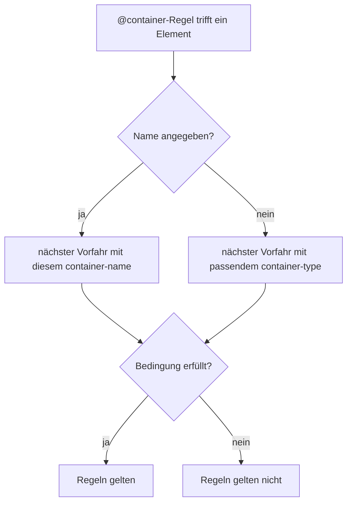

# Container Queries

## Kurz erklärt

Eine Media Query fragt: Wie breit ist das **Browserfenster**? Eine Container Query fragt: Wie breit ist das **Element, in dem ich gerade stecke**?

Das ist der Unterschied, auf den man bei Komponenten eigentlich immer gewartet hat. Eine Karte in der schmalen Seitenleiste und dieselbe Karte im breiten Hauptbereich sehen dann jeweils passend aus, egal wie breit das Fenster ist.[^comeau]

```css
.karten-spalte {
  container-type: inline-size;   /* 1. Container festlegen */
}

.karte {
  display: grid;
  gap: 1rem;
}

@container (width > 30rem) {     /* 2. Abfragen */
  .karte {
    grid-template-columns: 10rem 1fr;   /* Bild links, Text rechts */
  }
}
```

<a href="beispiele/container-01-karte.htm" target="_blank" rel="noopener">↗ Beispiel in neuem Tab öffnen</a>

## Hintergrund

### Warum man den Container ausdrücklich festlegen muss

Container Queries hat man sich rund 20 Jahre lang gewünscht. Dass es sie so lange nicht gab, hat einen handfesten Grund: Wenn CSS innerhalb einer Query die Größe des Containers verändert, kann die Bedingung danach nicht mehr stimmen. Dann gilt die Regel nicht mehr, der Container wird wieder kleiner, die Regel gilt wieder, und so weiter. Das Layout würde endlos hin- und herspringen.[^comeau][^mdn-styles]

Gelöst wurde das über **Containment**. Mit `container-type` sagt man dem Browser: Die Größe dieses Elements hängt nicht von seinem Inhalt ab. Dann kann nichts im Inneren die Messung verfälschen.[^mdn-type]

Das hat eine Nebenwirkung, die man kennen muss:

- `container-type: size` sperrt Breite **und Höhe**. Die Höhe ergibt sich normalerweise aus dem Inhalt. Wenn der Browser den Inhalt ignoriert, fällt der Container ohne feste Höhe auf 0 zusammen.[^comeau]
- `container-type: inline-size` sperrt nur die Breite (genauer: die Inline-Richtung). Die Breite kommt bei Blockelementen ohnehin vom Elternelement. Die Höhe wächst weiter mit dem Inhalt.

Deshalb nimmt man fast immer `inline-size`. Die Faustregel dazu lautet: **Man kann nicht ändern, was man misst.** Mit `inline-size` lassen sich nur Bedingungen auf die Breite stellen, nicht auf die Höhe.[^comeau]

### Welcher Container gemeint ist

Eine `@container`-Regel ohne Namen fragt immer den **nächsten Vorfahren** ab, der ein passender Container ist.[^mdn-styles] Daraus folgt: Ein Element kann sich nicht selbst abfragen. Die Karte braucht einen umgebenden Container, und das Wrapper-Element ist bei Container Queries völlig normal.



## Wichtige Aspekte

### Container benennen

Bei verschachtelten Containern ist ein Name übersichtlicher als „der nächste“:[^mdn-cq]

```css
.seitenleiste {
  container: seitenleiste / inline-size;   /* Kurzform für Name und Typ */
}

@container seitenleiste (width < 20rem) {
  .karte { font-size: 0.9rem; }
}
```

Ein Container darf mehrere Namen haben (`container-name: karte breit`), und die Namen unterscheiden zwischen Groß- und Kleinschreibung.[^mdn-styles]

### Was man abfragen kann

Bei Size Queries: `width`, `height`, `inline-size`, `block-size`, `aspect-ratio` und `orientation`. Bedingungen verknüpft man wie bei Media Queries mit `and`, `or` und `not`, und die Bereichsschreibweise funktioniert genauso:[^mdn-styles]

```css
@container (20rem <= width < 40rem) { … }
```

### Container-Einheiten

Innerhalb eines Size-Containers gibt es eigene Einheiten: `cqi` ist 1 % der Containerbreite (genauer: Inline-Größe), `cqb` 1 % der Höhe (Block-Größe). Dazu kommen `cqw`, `cqh`, `cqmin` und `cqmax`. Gibt es keinen passenden Container, rechnet der Browser mit den Small-Viewport-Einheiten (`svw` usw.).[^mdn-cq]

Damit lassen sich Schriftgrößen an die Komponente koppeln statt ans Fenster:

```css
.karte h2 {
  font-size: clamp(1.1rem, 0.8rem + 2cqi, 1.8rem);
}
```

<a href="beispiele/container-02-cqi-schrift.htm" target="_blank" rel="noopener">↗ Beispiel in neuem Tab öffnen</a>

Das `rem` im Mittelwert sorgt dafür, dass die Schrift beim Zoomen mitwächst (siehe [[grundlagen/berechnungen|CSS calc()]]).

### Style Queries

Mit `style()` fragt man keine Größe ab, sondern den **Wert einer Custom Property** am Container. Dafür braucht man kein `container-type`, denn jedes Element ist automatisch ein Style-Container. Normale Eigenschaften wie `style(font-weight: bold)` kann laut MDN noch kein Browser abfragen, nur Custom Properties.[^mdn-styles]

```css
.karte { --variante: normal; }
.karte.hervorgehoben { --variante: hervorgehoben; }

@container style(--variante: hervorgehoben) {
  .karte-titel { color: var(--akzent); }
}
```

<a href="beispiele/container-03-style-query.htm" target="_blank" rel="noopener">↗ Beispiel in neuem Tab öffnen</a>

Wichtig: Abgefragt wird der Container, also ein **Vorfahr**. Die Regel oben färbt den Titel *in* der Karte, nicht die Karte selbst.

Zwei Feinheiten:[^mdn-styles]

- `style(--x: 3)` vergleicht Text. Steht in `--x` der Wert `calc(6/2)`, ist das nicht dasselbe wie `3`. Für Zahlen gibt es die Vergleichsform `style(--x = 3)` bzw. `style(--x > 2)`, die rechnet. Für Schlüsselwörter wie `hervorgehoben` nimmt man den Doppelpunkt.
- Farben vergleicht der Browser nur dann sinnvoll (`blue` gleich `#00f`), wenn die Property mit `@property` und `syntax: "<color>"` registriert ist (siehe [[grundlagen/variablen|CSS Custom Properties]]).

### Weitere Arten

MDN zählt noch drei weitere Arten auf: Name-only Queries ohne Bedingung (`@container seitenleiste { … }`), Scroll-State Queries und Anchored Queries.[^mdn-styles] Scroll-State Queries sind in [[navigation/sticky-header|Sticky-Header einrichten]] im Einsatz, laufen aber bisher nur in Chrome und Edge.

## Beispiele

Karte, die je nach Platz zwischen untereinander und nebeneinander wechselt:

```html
<div class="karten-spalte">
  <article class="karte">
    
    <div>
      <h2>Überschrift</h2>
      <p>Teasertext …</p>
    </div>
  </article>
</div>
```

```css
.karten-spalte { container-type: inline-size; }

.karte { display: grid; gap: 1rem; }

@container (width > 30rem) {
  .karte { grid-template-columns: 10rem 1fr; }
}
```

Mit Nesting kann die Query direkt im Block der Karte stehen. So liegt alles, was die Karte betrifft, an einer Stelle:[^comeau]

```css
.karte {
  display: grid;
  gap: 1rem;

  @container (width > 30rem) {
    grid-template-columns: 10rem 1fr;
  }
}
```

## Fallstricke

- **Container mit `size` fällt zusammen.** Ohne feste Höhe ist er 0 hoch, und der Inhalt läuft heraus. In den meisten Fällen ist `inline-size` gemeint.[^comeau][^mdn-type]
- **Container, deren Breite vom Inhalt abhängt.** Auch `inline-size` ignoriert den Inhalt, aber eben nur bei der Breite. Ein Element, das seine Breite *aus* dem Inhalt bezieht (zum Beispiel `display: inline-block`, `width: fit-content` oder ein Flex-Item ohne feste Basis), verliert damit seine Breite. Den Container also auf ein Element legen, dessen Breite von außen kommt. (Eigene Ableitung, nicht aus den Quellen. In Chrome 155 nachgeprüft: Ein `inline-block` und ein Flex-Item mit `container-type: inline-size` waren jeweils 0px breit.)
- **Ein Element kann sich nicht selbst abfragen.** Die Regel in `@container` gilt für Nachfahren des Containers. Braucht die Karte selbst ein anderes Layout, muss ein Wrapper der Container sein.
- **Media Queries bleiben richtig für Seitenlayout.** Ob die Seitenleiste neben oder unter dem Inhalt steht, hängt vom Fenster ab. Container Queries sind für das, was *in* den Bereichen passiert.

<a href="beispiele/container-04-fallstricke.htm" target="_blank" rel="noopener">↗ Beispiel in neuem Tab öffnen</a>

### Browsersupport

Laut `web-features` 3.43.0, abgefragt am 2026-10-18:

| Feature | Baseline | Seit | Ab Version |
| --- | --- | --- | --- |
| Container Queries (Size) | widely available | 2025-08-14 (newly: 2023-02-14) | Chrome/Edge 105, Firefox 110, Safari 16 |
| Style Queries | newly available | 2026-05-19 | Chrome/Edge 111, Firefox 151, Safari 18 |
| Scroll-State Queries | **nicht Baseline** | – | bisher nur Chrome/Edge 133 |

Die Vergleichsform `style(--x = 3)` führt `web-features` nicht als eigenen Eintrag. In Chrome 155 funktioniert sie, Firefox und Safari habe ich nicht geprüft.

## Eigene Notizen / Einordnung

Die Arbeitsteilung, die sich daraus ergibt: **Media Queries für das Seitengerüst, Container Queries für Komponenten.** Eine Karte, die ihre eigene Breite kennt, kann man überall einsetzen, ohne für jede Stelle eigene Breakpoints zu pflegen.

Style Queries sind spannend, weil sie Varianten ohne zusätzliche Klassen an jedem Kindelement ermöglichen: Eine Custom Property am Container reicht. Da sie erst seit Mai 2026 in allen aktuellen Browsern laufen, sollte die Darstellung ohne sie noch brauchbar bleiben.

## Siehe auch

- [[selektoren/has|CSS-Pseudoklasse has()]] – reagiert auf den Inhalt, nicht auf die Größe
- [[selektoren/nesting|CSS-Nesting]]
- [[grundlagen/variablen|CSS Custom Properties]]
- [[navigation/sticky-header|Sticky-Header einrichten]] – Scroll-State Query für den angedockten Zustand

## Quellen

- [[quellen/artikel/container-queries-mdn|Container Queries (MDN)]] — Grundlagen, Namen, Kurzform, Einheiten
- [[quellen/artikel/style-queries-mdn|Container Size und Style Queries (MDN)]] — warum Containment, abfragbare Merkmale, Style Queries, Vergleichsformen
- [[quellen/artikel/container-type-mdn|container-type CSS-Eigenschaft (MDN)]] — Werte, Size Containment, Zusammenfallen
- [[quellen/artikel/container-queries-comeau|A Friendly Introduction to Container Queries (Josh W. Comeau)]] — das Endlosschleifen-Problem, `size` gegen `inline-size`, die Faustregel

Eigene Ergänzungen: das Diagramm, die Kartenbeispiele (angelehnt an MDN und Comeau), die Fallstricke zu Containern mit inhaltsabhängiger Breite und zum Selbstabfragen, die Einordnung Media vs. Container Query.

Alle Codebeispiele habe ich am 2026-10-18 in Chrome 155 nachgestellt: Kartenlayout (auch mit Nesting), zusammenfallender `size`-Container, Selbstabfrage, benannter Container, `cqi`-Schriftgröße, Style Query mit Schlüsselwort, Text- gegen Zahlenvergleich und registrierte gegen nicht registrierte Farben. Firefox und Safari habe ich nicht getestet.

[^comeau]: [[quellen/artikel/container-queries-comeau|A Friendly Introduction to Container Queries (Josh W. Comeau)]], Abschnitte „The basic idea“, „Solving an impossible problem“, „Our first container query“, 2024-11-04.
[^mdn-cq]: [[quellen/artikel/container-queries-mdn|Container Queries (MDN)]], Abschnitte „Naming containment contexts“, „Shorthand container syntax“, „Container query length units“, Stand 2026-07-08.
[^mdn-styles]: [[quellen/artikel/style-queries-mdn|Container Size und Style Queries (MDN)]], Abschnitte „Container size queries“, „Naming containers“, „Container style queries“, „Plain versus range syntax“, Stand 2026-10-14.
[^mdn-type]: [[quellen/artikel/container-type-mdn|container-type CSS-Eigenschaft (MDN)]], Abschnitte „Values“ und „Container size queries“, Stand 2026-10-16.
