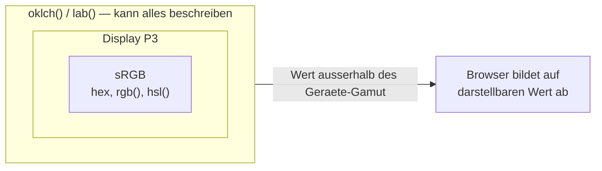

# Farben in CSS

## Kurz erklärt

In CSS gibt es mehrere Schreibweisen für Farben. Der wichtigste Unterschied zwischen ihnen ist, **wie gut man Farben damit verändern kann**. Für einzelne feste Werte ist es egal, welche man nimmt. Bei Farbsystemen, Themes und Zuständen wie Hover oder Disabled entscheidet die Wahl aber darüber, wie viel Arbeit man hat.

Grobe Einteilung:

- **Am Bildschirm orientiert, nicht an der Wahrnehmung:** Farbnamen, Hex, `rgb()`, `hsl()`
- **An der Wahrnehmung orientiert:** `lab()`, `lch()`, `oklab()`, `oklch()`

## Hintergrund

Was das in der Praxis heißt, sieht man an `hsl()`. Dort sollte gleiche Lightness eigentlich gleiche Helligkeit bedeuten, tut sie aber nicht: `hsl(60, 100%, 50%)` (Gelb) wirkt deutlich heller als `hsl(240, 100%, 50%)` (Blau), obwohl beide `L: 50%` haben. Wer damit eine Farbpalette baut, muss jeden Farbton von Hand nachjustieren.

Genau dieses Problem lösen die Modelle, die sich an der Wahrnehmung orientieren: Bei gleicher Lightness wirken Farben gleich hell, egal welcher Farbton. Abstufungen (`--brand-500`, `--brand-600` usw.) und Kontraste lassen sich dann ausrechnen, statt sie nach Gefühl festzulegen.

Am praktischsten ist OKLCH. Es behebt die Schwächen von LCH bei stark gesättigten Farben, und seine Werte versteht man sofort: Helligkeit, Buntheit, Farbton.

## Wichtige Aspekte

### Wertebereiche im Vergleich

| Notation | Parameter | Wertebereiche |
| --- | --- | --- |
| Hex | R, G, B (, A) | je `00`–`FF`; Kurzform `#FC0` |
| `rgb()` | R, G, B | `0`–`255` oder `0%`–`100%` |
| `hsl()` | H, S, L | `0`–`360`, `0%`–`100%`, `0%`–`100%` |
| `lab()` | L, a, b | Helligkeit; Achsen ca. `-128`–`+127` |
| `lch()` | L, C, H | `0%`–`100%`, `0`–ca. `130`, `0`–`360` |
| `oklch()` | L, C, H | `0`–`1`, `0`–ca. `0.4`, `0`–`360` |

Bei HSL ist der Hue-Winkel so belegt: 0 Rot, 60 Gelb, 120 Grün, 180 Cyan, 240 Blau, 300 Magenta. Das Gradzeichen lässt man weg.

**In OKLCH und LCH liegen die Farbtöne woanders.** In Chrome 155 nachgemessen (2026-10-18):

| Farbe | HSL | OKLCH | LCH |
| --- | --- | --- | --- |
| Rot (`red`) | 0 | 29 | 41 |
| Gelb (`yellow`) | 60 | 110 | 100 |
| Grün (`lime`) | 120 | 142 | 134 |
| Cyan (`cyan`) | 180 | 195 | 196 |
| Blau (`blue`) | 240 | 264 | 301 |
| Magenta (`magenta`) | 300 | 328 | 327 |

Wer Hue-Werte aus HSL in `oklch()` übernimmt, bekommt also einen anderen Farbton. Die Palettenbeispiele unten nutzen deshalb 25, 145 und 250.

### Alphakanal

Jede Notation kann Transparenz: als viertes Hex-Paar (`#FF000080`), über `rgba()`/`hsla()` oder, moderner und überall gleich, mit Schrägstrich: `oklch(0.7 0.2 240 / 50%)`. `rgba()` und `hsla()` sind heute nur noch andere Namen für `rgb()` und `hsl()`, die den Alphawert selbst annehmen.

### Gamut

Hohe Chroma-Werte liegen außerhalb von sRGB und lassen sich nur in größeren Farbräumen wie Display P3 darstellen. Kann ein Bildschirm die Farbe nicht zeigen, nimmt der Browser die nächstliegende, die er zeigen kann. Wer auf allen Geräten verlässliche Ergebnisse will, bleibt im sRGB-Bereich oder arbeitet gezielt mit `@media (color-gamut: p3)`.



Der Unterschied liegt nicht in der Syntax, sondern im Umfang: Mit `hsl()` **kann** man keine Farbe außerhalb von sRGB angeben, mit `oklch()` schon. Ob sie auch so ankommt, hängt vom Bildschirm ab.

### Mischen mit `color-mix()`

`color-mix()` mischt zwei Farben **erst im Browser**, also zur Laufzeit:

```css
:root { --brand: oklch(0.55 0.14 210); }

.button:hover {
  background: color-mix(in oklab, var(--brand) 80%, black);
}
```

<a href="beispiele/farben-01-color-mix.htm" target="_blank" rel="noopener">↗ Beispiel in neuem Tab öffnen</a>

Zwei Dinge sind daran wichtig:

1. Den Farbraum gibt man mit `in oklab`, `in srgb` usw. an. Ursprünglich war das Pflicht. In Chrome 155 ist `color-mix(red, blue)` auch ohne `in` gültig und mischt dann in Oklab (am 2026-10-18 nachgeprüft). Ältere Browser verwerfen den Ausdruck ohne `in`, deshalb schreibt man den Farbraum besser immer dazu.
2. Es funktioniert mit CSS-Variablen. Damit ersetzt es nicht nur Funktionen wie `mix()` aus Sass, sondern kann etwas, das die grundsätzlich nicht können: Es reagiert auf Werte, die erst im Browser gesetzt werden, also auf Themes, Dark Mode und Nutzereinstellungen.

Der Farbraum, in dem gemischt wird, bestimmt das Ergebnis: `in oklab` ergibt gleichmäßigere Übergänge als `in srgb`, das bei Komplementärfarben durch ein matschiges Grau läuft.

### Ableiten mit relativen Farbangaben

`color-mix()` mischt zwei fertige Farben. Die **relative Farbsyntax** aus CSS Color Level 5 geht einen Schritt weiter: Sie zerlegt eine Ausgangsfarbe in ihre Kanäle und setzt sie neu zusammen. Das Schlüsselwort dafür ist `from`:

```css
:root { --bg-color: blue; }
.overlay { background: rgb(from var(--bg-color) r g b / 20%); }
```

<a href="beispiele/farben-02-relative-farbe.htm" target="_blank" rel="noopener">↗ Beispiel in neuem Tab öffnen</a>

Die Kanäle heißen wie die Buchstaben des jeweiligen Farbmodells (`r g b`, `l c h`, `l a b`), die Deckkraft heißt `alpha`. Soll ein Kanal bleiben, wie er ist, schreibt man einfach seinen Buchstaben hin. Soll er sich ändern, rechnet man mit ihm, siehe [[grundlagen/berechnungen|CSS calc()]]:

```css
:root {
  --base: oklch(0.55 0.14 210);

  /* Helligkeitsstufen */
  --base-light: oklch(from var(--base) calc(l + 0.25) c h);
  --base-dark:  oklch(from var(--base) calc(l - 0.25) c h);

  /* Harmonien über den Farbtonwinkel */
  --accent-warm:       oklch(from var(--base) l c calc(h + 20));
  --accent-complement: oklch(from var(--base) l c calc(h + 180));
  /* triadisch: calc(h + 120) und calc(h - 120) */
}
```

<a href="beispiele/farben-03-farbfamilie.htm" target="_blank" rel="noopener">↗ Beispiel in neuem Tab öffnen</a>

Damit verschwindet die häufigste Sorte **Magic Number** aus dem Stylesheet: Statt `#3a7bd5` und daneben `#2a6bb8` ohne erkennbaren Zusammenhang sieht man im Code, wie die eine Farbe aus der anderen entsteht.

Zwei Dinge muss man dabei beachten:

1. **Jedes Farbmodell hat eigene Wertebereiche.** In OKLCH liegt L zwischen 0 und 1, also `calc(l + 0.25)`. In LCH ist L ein Prozentwert von 0 bis 100, dort wäre `calc(l + 25)` richtig. Wer Beispiele von einem Modell ins andere kopiert, landet schnell bei reinem Weiß oder Schwarz.
2. **Die Ausgangsfarbe darf in jedem beliebigen Modell angegeben sein**, CSS rechnet um. Rechnet man eine Farbe außerhalb von sRGB in `rgb()` um, kommt dabei eine Ersatzfarbe heraus.

Für Schriftfarben auf berechneten Hintergründen gibt es außerdem `contrast-color(var(--tone))`: Der Browser sucht selbst die Farbe mit dem besten Kontrast aus. **Für den Produktiveinsatz ist das noch zu früh:** `contrast-color()` ist erst seit 2026-04-10 Baseline *newly available* (Chrome/Edge 147, Firefox 146, Safari 26), also gerade ein halbes Jahr alt. Bis auf Weiteres ist es sicherer, die Farbe selbst zu berechnen und den Kontrast zu prüfen.

### Farbinterpolation

Sobald CSS von einer Farbe zur anderen *übergeht*, stellt sich die Frage nach dem Farbraum. Das gilt für `transition` und `animation`, Verläufe, Filter und `color-mix()` gleichermaßen. Angegeben wird er mit `in`:

```
in <system> [ <richtung> hue ]
```

| System | Verhalten |
| --- | --- |
| `srgb` | technisch einfach, aber nicht an der Wahrnehmung ausgerichtet. Verläufe wirken oft zu dunkel oder grau |
| `srgb-linear`, `xyz`, `xyz-d50`, `xyz-d65` | lineare Lichtstärke, wie wenn man farbiges Licht mischt |
| `lab`, `oklab` | näher an der Wahrnehmung, gleichmäßiger Übergang |
| `hsl`, `hwb` | über den Farbkreis. Von Rot nach Blau ergibt das eher einen Regenbogen als einen Übergang |
| `lch`, `oklch` | über den Farbkreis und an der Wahrnehmung ausgerichtet, ohne das „Ausgrauen“ |

Bei den Systemen mit Farbkreis kommt die **Drehrichtung** dazu: `shorter` (Standard, der kürzere Weg), `longer` (der längere Weg), `increasing` und `decreasing` (Winkel immer größer bzw. immer kleiner werdend, egal wie lang der Weg ist). `color-mix(in oklch longer hue, …)` nimmt also absichtlich den langen Weg um den Farbkreis.

### HSL ist nicht HSB/HSV

Eine Falle, wenn man Farben aus der Bildbearbeitung ins CSS holt: Das W3C hat sich für **HSL** entschieden, Photoshop und viele Color Picker (auch der von macOS) arbeiten dagegen mit **HSB**, auch HSV genannt. Der Farbton ist bei beiden gleich, Sättigung und Helligkeit sind es nicht.

HSB (300, 18 %, 78 %) entspricht HSL (300, 24 %, 71 %). Wer die Zahlen unverändert überträgt, bekommt den richtigen Farbton mit falscher Sättigung und falscher Helligkeit und sucht den Fehler dann lange an der falschen Stelle.

**Faustregel: Aus einem Bildbearbeitungsprogramm nie HSB-Zahlen übernehmen.** Lieber Hex oder RGB nehmen oder die Farbe gleich in OKLCH bestimmen.

## Beispiele

Eine Palette, in der alle Farben gleich hell wirken. In OKLCH ist das ein Kinderspiel, in HSL Handarbeit:

```css
:root {
  --blue-500:  oklch(0.60 0.20 250);
  --green-500: oklch(0.60 0.20 145);
  --red-500:   oklch(0.60 0.20  25);
  /* gleiche wahrgenommene Helligkeit, gleiche Buntheit */
}
```

<a href="beispiele/farben-04-gleiche-helligkeit.htm" target="_blank" rel="noopener">↗ Beispiel in neuem Tab öffnen</a>

Abstufungen desselben Farbtons über die Lightness:

```css
:root {
  --brand-300: oklch(0.80 0.12 210);
  --brand-500: oklch(0.60 0.14 210);
  --brand-700: oklch(0.40 0.12 210);
}
```

<a href="beispiele/farben-05-farbskala.htm" target="_blank" rel="noopener">↗ Beispiel in neuem Tab öffnen</a>

## Eigene Notizen / Einordnung

Faustregel für neue Projekte: **Farben in OKLCH festlegen, mit `color-mix(in oklab, …)` ableiten und Hex nur noch dort verwenden, wo ein Wert von außen kommt** (Corporate Design, exportierte Design-Tokens, Snippets von Drittanbietern).

Ergänzung nach den SELFHTML-Quellen (2026-09-03): Für Paletten ist die relative Syntax `oklch(from …)` besser als `color-mix()`, weil man daran sieht, **welcher Kanal** sich ändert. `color-mix()` bleibt für Zustände (Hover, Disabled) und als Fallback für ältere Browser die richtige Wahl. Am besten pflegt man eine einzige Grundfarbe `--base` und leitet Stufen, Akzente und Kontraste daraus ab. Dann ändert ein Theme genau einen Wert.

`hsl()` taugt weiter für schnelle Handarbeit, weil man den Farbton im Kopf hat. Sobald aber mehrere Farben systematisch zusammenpassen sollen, ist es die falsche Grundlage.

### Browsersupport

| Feature | Baseline | Seit | Ab Version |
| --- | --- | --- | --- |
| OKLab/OKLCH | widely available | 2025-11-09 (newly: 2023-05-09) | Chrome 111, Firefox 113, Safari 15.4 |
| `color-mix()` | widely available | 2025-11-09 (newly: 2023-05-09) | Chrome 111, Firefox 113, Safari 16.2 |
| Relative Farbangaben (`from`) | newly available | 2024-09-16 | Chrome 125, Firefox 128, Safari 18 |
| `contrast-color()` | newly available | 2026-04-10 | Chrome 147, Firefox 146, Safari 26 |
| `color-mix()` mit drei oder mehr Farben | **nicht Baseline** | – | bisher nur Firefox 150 |

Für den Alltag heißt das: OKLCH und `color-mix()` mit zwei Farben kann man bedenkenlos einsetzen. Relative Farbangaben und `contrast-color()` brauchen einen Fallback. `color-mix()` mit mehr als zwei Farben ist derzeit nicht brauchbar, drei Farben mischt man verschachtelt.

Quelle: `web-features` 3.36.0 (Baseline-Daten der W3C WebDX Community Group), lokal abgefragt am 2026-09-03.

## Siehe auch

- [[selektoren/nesting|CSS-Nesting]]
- [[grundlagen/variablen|CSS Custom Properties]] — Träger der Farbtokens
- [[grundlagen/berechnungen|CSS calc()]] — die Rechenvorschrift in den Farbkanälen

## Quellen

- [[quellen/artikel/farben-in-der-praxis|CSS Farben in der Praxis – von Hexadezimal bis oklch()]] — Notationen und Wertebereiche
- [[quellen/artikel/color-mix-funktion|CSS color-mix() Funktion]] — Mischen in CSS; dort auch der Hinweis, dass der Standardfarbraum entgegen der Quelle Oklab ist und nicht `lch`
- [[quellen/artikel/relative-farbangaben|Relative Farbangaben (SELFHTML)]] — `from`-Syntax, abgeleitete Paletten, Farbinterpolation und Drehrichtung
- [[quellen/artikel/farbrechner|Farbrechner – OKLCH, HSL, HSV, RGB und Hex umrechnen]] — HSL vs. HSB/HSV, OKLCH-Farbrad, Light-/Dark-Paletten

Die Kritik an HSL, die Empfehlung zum Mischfarbraum und die Faustregel oben stammen nicht aus den Quellen, sondern sind eigene Einordnung. Ebenfalls eigene Ergänzung ist der Hinweis auf die unterschiedlichen L-Wertebereiche von OKLCH und LCH. Die SELFHTML-Quelle enthält an einer Stelle ein Beispiel, das diese Bereiche verwechselt.
