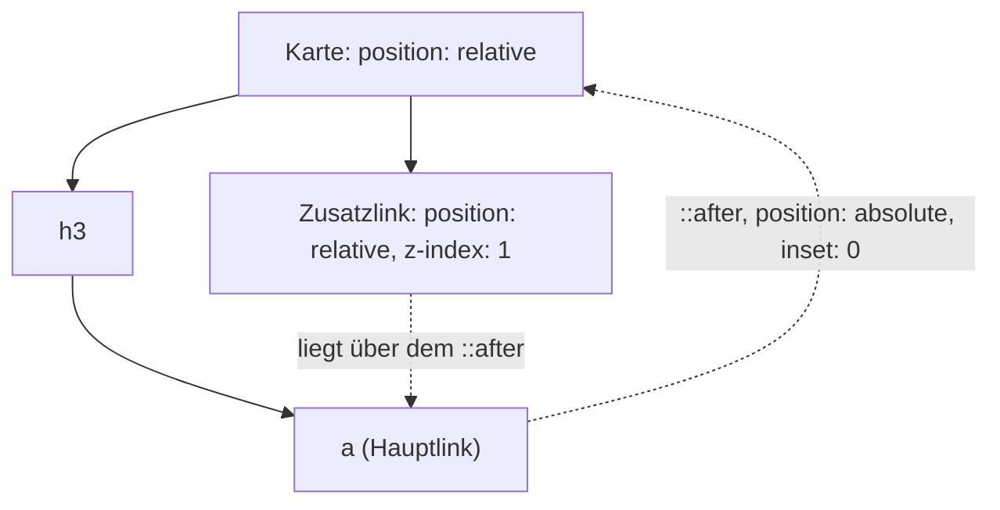

# Ganze Karte klickbar machen

## Ziel

Eine Karte (Teaser, Produktkachel, Listeneintrag) soll **überall** anklickbar sein, nicht nur auf der Überschrift. Gleichzeitig soll ein Screenreader den Link kurz und verständlich vorlesen, und die Karte soll weitere Links oder Buttons enthalten dürfen.

## Voraussetzungen

- Eine Karte mit **einem** eindeutigen Hauptlink, meist auf der Überschrift.
- Kein JavaScript nötig. Alle verwendeten CSS-Features sind Baseline *widely available*.

## Getestet mit / Stand

Stand 2026-10-18. In **Chrome 155** nachgeprüft: Ein Klick auf den Teasertext landet beim Hauptlink, der Autorenlink bleibt einzeln anklickbar, der Mauszeiger ist über der ganzen Karte eine Hand, die Karte zeigt beim Tab auf den Hauptlink den Ring und beim Tab auf den Autorenlink nicht, und Text lässt sich nicht markieren. **Mit Screenreadern habe ich nicht getestet.** Adrian Roselli hat das Muster nach eigener Aussage mit NVDA und VoiceOver geprüft (Stand 2020).[^roselli]

## Vorgehen

### Warum nicht einfach alles in ein `<a>` packen?

Der naheliegende Weg ist, die ganze Karte in einen Link zu wickeln:

```html
<!-- So lieber nicht -->
<a href="/artikel" class="karte">
  
  <h3>Überschrift</h3>
  <p>Teasertext mit zwei, drei Sätzen …</p>
  <small>Von Autorin X</small>
</a>
```

Das ist gültiges HTML, hat aber drei Nachteile:

- **Der Link wird sehr lang vorgelesen.** Alles in der Karte wird zum Linktext. Ein Screenreader liest also „Überschrift, Teasertext mit zwei, drei Sätzen, von Autorin X, Link“. In Rosellis Test dauerte das rund 25 Sekunden, bevor überhaupt klar war, dass es sich um einen Link handelt.[^roselli]
- **Linklisten werden unbrauchbar.** Screenreader können alle Links einer Seite als Liste anzeigen. Dort will man „Überschrift, Link" lesen und nicht den ganzen Teaser.[^giraudel][^pickering]
- **Keine weiteren Links möglich.** Links dürfen nicht in Links stecken. Ein Autorenlink in der Karte geht also nicht.[^pickering]

### 1. Link nur auf die Überschrift setzen

```html
<li class="karte">
  
  <h3><a href="/artikel">Überschrift</a></h3>
  <p>Teasertext mit zwei, drei Sätzen …</p>
  <small>Von Autorin X</small>
</li>
```

Der Link hat jetzt einen kurzen, eindeutigen Namen. Ein „Weiterlesen"-Link ist überflüssig.

### 2. Klickfläche über die ganze Karte ziehen

Der Trick: Man positioniert ein Pseudoelement des Links absolut und spannt es über die ganze Karte. Ein Klick irgendwo auf der Karte landet dann auf dem Link.[^pickering][^giraudel]

```css
.karte {
  position: relative;          /* Bezugsrahmen für das Pseudoelement */
}

.karte h3 a::after {
  content: "";
  position: absolute;
  inset: 0;                    /* deckt die ganze Karte ab */
}
```

`inset: 0` ist die Kurzform für `top`, `right`, `bottom` und `left` auf 0. Ältere Quellen schreiben die vier Eigenschaften einzeln aus.[^roselli]

Der Mauszeiger wird über der ganzen Karte automatisch zur Hand, weil dort ja tatsächlich der Link liegt.[^pickering]

### 3. Hover und Fokus an der Karte zeigen

Wenn die ganze Karte klickbar ist, sollte man das auch sehen, mit der Maus und mit der Tastatur. `:focus-within` reagiert, sobald irgendetwas in der Karte den Fokus hat:[^pickering]

```css
.karte:hover,
.karte:focus-within {
  box-shadow: 0 0 0 3px var(--akzent);
}

/* Fokusring am Link selbst nur entfernen, wenn die Karte ihn übernimmt */
.karte:focus-within h3 a:focus {
  outline: none;
}
```

Moderner und genauer ist `:has()` mit `:focus-visible`. Damit zeigt die Karte den Ring nur bei Tastaturbedienung und nur dann, wenn wirklich der **Hauptlink** den Fokus hat und nicht ein anderer Button in der Karte (eigene Variante, nicht aus den Quellen, siehe auch [[komponenten/fokusstile|Sichtbare Fokusstile]]):

```css
.karte:has(h3 a:focus-visible) {
  outline: 3px solid var(--akzent);
  outline-offset: 2px;
}
.karte h3 a:focus-visible {
  outline: none;
}
```

<a href="beispiele/karte-01-klickbar.htm" target="_blank" rel="noopener">↗ Beispiel in neuem Tab öffnen</a>

### 4. Weitere Links oder Buttons in der Karte

Weil die Karte selbst kein Link ist, dürfen weitere Bedienelemente hinein. Sie liegen aber zunächst **unter** dem Pseudoelement und wären nicht klickbar. Man muss sie also nach oben holen:

```css
.karte small a,
.karte button {
  position: relative;
  z-index: 1;
}
```

Pickering weist darauf hin, dass `position: relative` allein schon reicht, wenn das Element im Quelltext **nach** dem Hauptlink steht, denn dann liegt es ohnehin oben. `z-index` braucht man erst, wenn es davor steht.[^pickering] Giraudel setzt es vorsichtshalber immer.[^giraudel]

Wichtig für die Bedienbarkeit: **Abstand lassen.** Wer einen kleinen Autorenlink knapp verfehlt, landet sonst auf dem Hauptlink. Roselli empfiehlt, die Klickfläche des Hauptlinks gezielt zu verkleinern, damit um das zweite Bedienelement herum eine Zone bleibt, in der ein Klick nichts auslöst:[^roselli][^giraudel]

```css
/* Klickfläche endet über der Fußzeile mit dem Zusatzbutton */
.karte h3 a::after {
  inset: 0 0 3.75em 0;
}
```

Den genauen Wert muss man ans eigene Layout anpassen.

### 5. Bild vor der Überschrift, aber nur optisch

Oft soll das Bild oben stehen. Im HTML gehört es aber hinter die Überschrift, weil eine Überschrift einen Abschnitt **einleitet**. Die Reihenfolge dreht man dann nur optisch um:[^roselli]

```css
.karte {
  display: flex;
  flex-direction: column;
}
.karte img {
  order: -1;                   /* optisch nach oben */
}
```

Das ist einer der wenigen Fälle, in denen das Umsortieren per CSS sinnvoll ist: Die Lese- und Tab-Reihenfolge bleibt logisch, nur die Optik ändert sich.

## Warum funktioniert das?

Ein Pseudoelement gehört zu seinem Element. Ein Klick auf `a::after` ist für den Browser ein Klick auf das `a`. Mit `position: absolute` richtet sich das Pseudoelement nicht am Link aus, sondern am nächsten positionierten Vorfahren, und das ist die Karte mit `position: relative`. Mit `inset: 0` füllt es diese ganz aus.

Für Screenreader ändert sich dabei nichts: Das Pseudoelement hat keinen Inhalt (`content: ""`), der Link heißt weiterhin nur „Überschrift".



## Fallstricke

- **Text lässt sich nicht mehr markieren.** Das Pseudoelement liegt wie eine Folie über der Karte. Wer den Teasertext kopieren will, kann das nicht.[^pickering][^roselli] Einzelne Elemente anzuheben (`position: relative`) hilft, reißt aber Lücken in die Klickfläche. Pickering zeigt als Alternative eine JavaScript-Lösung, die Klicks auf der Karte an den Link weiterreicht und Markieren erkennt (mehr als 200 ms zwischen `mousedown` und `mouseup`).[^pickering] Ob sich das lohnt, muss man im Einzelfall abwägen. Bei kurzen Teasern meist nicht.
- **Kein `position` an Elementen dazwischen.** Hat ein Element zwischen Karte und Link (zum Beispiel die `h3`) selbst `position: relative`, spannt sich das Pseudoelement nur über dieses Element. Dann ist nur die Überschrift klickbar. (Eigene Ableitung aus der Funktionsweise von `position: absolute`, in Chrome 155 bestätigt.) <a href="beispiele/karte-02-zwischenelement.htm" target="_blank" rel="noopener">↗ Beispiel in neuem Tab öffnen</a>
- **Ganze Tabellenzeilen klickbar machen** geht nach demselben Prinzip, gilt bei Roselli aber selbst schon als fragwürdiges Muster.[^roselli]
- **Nicht in einen `<button>` packen.** Bei Buttons ist das noch schlimmer als bei Links, denn Überschriften in einem Button verlieren ihre Bedeutung als Überschrift.[^roselli]

### Browsersupport

Laut `web-features` 3.43.0 (abgefragt 2026-10-18) alles Baseline *widely available*: `:focus-within` seit 2022-07-15, `:focus-visible` seit 2024-09-14, `:has()` seit 2026-06-19. `inset` und `order` sind ältere Standardeigenschaften und hier nicht einzeln abgefragt.

## Siehe auch

- [[selektoren/nach-inhalt-auswaehlen|Elemente anhand ihres Inhalts auswählen]]
- [[selektoren/has|CSS-Pseudoklasse has()]]
- [[navigation/hauptnavigation|Hauptnavigation semantisch aufbauen]]

## Quellen

- [[quellen/artikel/cards-pickering|Cards (Inclusive Components)]] — Heydon Pickering, 2018: Pseudoelement-Trick, Textauswahl-Problem, JavaScript-Alternative, `:focus-within`
- [[quellen/artikel/cards-giraudel|Accessible Cards (Kitty Giraudel)]] — 2022: Begründung „nur Überschrift verlinken", verschachtelte Aktionen
- [[quellen/artikel/block-links-roselli|Block Links, Cards, Clickable Regions, Rows (Adrian Roselli)]] — 2020, aktualisiert 2025: Screenreader-Verhalten, Abstand um Zusatzbedienelemente, Bild-Reihenfolge, Buttons

Eigene Ergänzungen: die Variante mit `:has()` und `:focus-visible`, der Fallstrick zu `position` an Zwischen-Elementen, das Diagramm. Der Fokusstil in Schritt 3 folgt Pickerings Prinzip, ist aber vereinfacht (er nutzt `box-shadow` und `text-decoration` statt `outline`).

[^pickering]: [[quellen/artikel/cards-pickering|Cards (Inclusive Components)]], Abschnitte „The pseudo-content trick", „The redundant click event", „Affordance", 2018-06-04.
[^giraudel]: [[quellen/artikel/cards-giraudel|Accessible Cards (Kitty Giraudel)]], Abschnitte „Markup", „CSS", „Nested actions", 2022-04-02, bearbeitet 2026-04-24.
[^roselli]: [[quellen/artikel/block-links-roselli|Block Links, Cards, Clickable Regions, Rows (Adrian Roselli)]], Abschnitte „Links", „Variations", „Buttons", Update 2020-03-31; Artikel von 2020-02-17, aktualisiert 2025-09-29.
