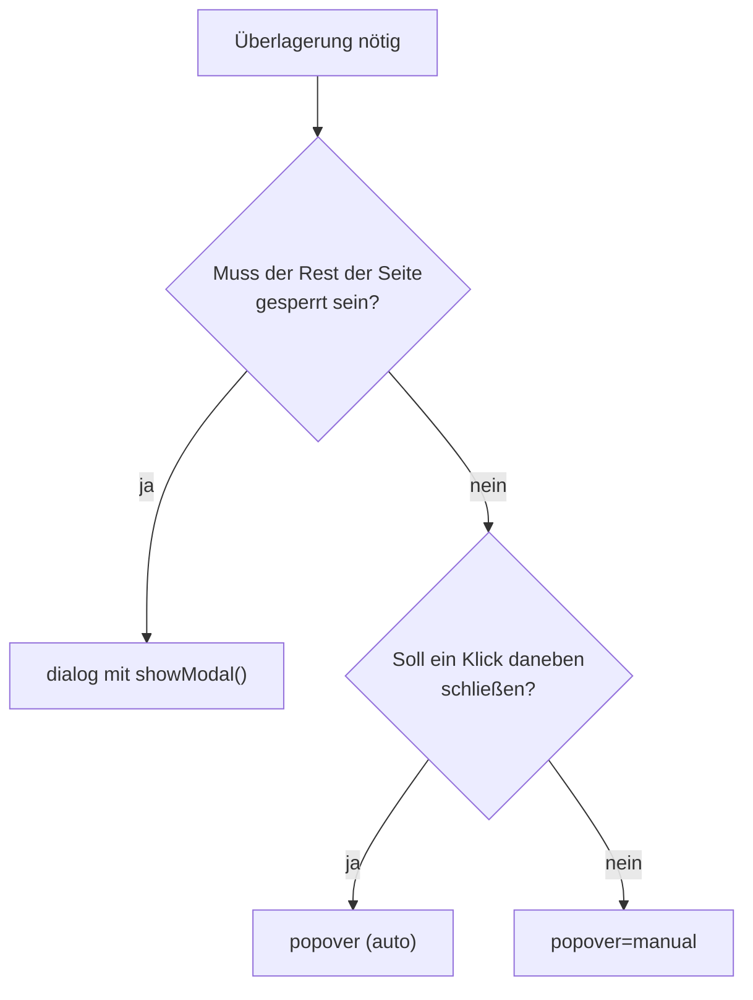

# Top Layer mit popover und dialog

## Kurz erklärt

`popover` und `dialog` zeigen Inhalte **über allem anderen auf der Seite** an, im sogenannten Top Layer.[^mdn-popover] In der Praxis heißt das: Ein Gerangel um `z-index` und ein Vorfahr, der mit `overflow` etwas abschneidet, spielen dort keine Rolle mehr. Das war zuerst eine eigene Ableitung. Inzwischen steht es ausdrücklich im Entwurf von CSS Positioned Layout Level 4: Elemente im Top Layer verhalten sich wie Geschwister des Wurzelelements und können von nichts im Dokument abgeschnitten werden.[^css-position-4]

Der Unterschied liegt im Verhalten:

- **`popover`** ist ein Attribut für nicht modale Überlagerungen wie Untermenüs, Hinweise oder Toasts. Die Seite bleibt bedienbar, und ein Klick daneben schließt das Popover.
- **`dialog`** mit `showModal()` ist ein modaler Dialog: Der Rest der Seite ist gesperrt (inert), und der Fokus bleibt im Dialog.[^mdn-dialog]

```html
<button popovertarget="info">Info</button>
<div id="info" popover>Nicht modal, schließt bei Klick daneben.</div>

<button commandfor="frage" command="show-modal">Löschen …</button>
<dialog id="frage">
  <p>Wirklich löschen?</p>
  <button commandfor="frage" command="close">Abbrechen</button>
</dialog>
```

<a href="beispiele/top-layer-01-popover-und-dialog.htm" target="_blank" rel="noopener">↗ Beispiel in neuem Tab öffnen</a>

## Hintergrund

Überlagerungen waren lange Handarbeit: `position: fixed`, ein hoher `z-index` und JavaScript für Öffnen, Schließen, `Esc`, Fokus und `aria-expanded`. Vieles davon übernimmt inzwischen der Browser, aber nicht alles, und bei `popover` und `dialog` nicht dasselbe.

## Wichtige Aspekte

### Was der Browser jeweils übernimmt

| | `popover` (`auto`) | `popover="manual"` | `dialog` mit `show()` | `dialog` mit `showModal()` |
| --- | --- | --- | --- | --- |
| Top Layer | ja | ja | nein | ja |
| Rest der Seite inert | nein | nein | nein | ja |
| `Esc` schließt | ja | nein | nein | ja |
| Klick daneben schließt | ja | nein | nein | nur mit `closedby="any"` |
| Mehrere gleichzeitig offen | nein, außer verschachtelt | ja | – | – |
| `::backdrop` | ja | ja | nein | ja |

Quellen der Zeilen: [[quellen/artikel/popover-api-mdn|Using the Popover API (MDN)]] und [[quellen/artikel/dialog-element-mdn|dialog-Element (MDN)]]. Zwei Zellen stehen dort nicht wörtlich, sondern sind abgeleitet: dass `show()` den Dialog nicht in den Top Layer legt und dass `Esc` ein `manual`-Popover nicht schließt. MDN nennt den Top Layer nur für Popovers und modale Dialoge und das Schließen per `Esc` nur für `auto`-Popovers. In Chrome 155 habe ich beides am 2026-10-18 bestätigt: Ein mit `show()` geöffneter Dialog lag unter einem Element mit maximalem `z-index`, ein mit `showModal()` geöffneter darüber. Ein `manual`-Popover blieb nach `Esc` offen.

### Popover: Zustände und Steuerung

- `popover` ohne Wert bedeutet `auto`. Öffnet man ein zweites `auto`-Popover, schließt sich das erste. Verschachtelte dürfen gleichzeitig offen sein. `showModal()` an einem anderen Element schließt `auto`-Popovers.[^mdn-popover]
- Ohne JavaScript steuert man es über einen Button mit `popovertarget` (die Aktion legt `popovertargetaction` fest: `toggle`, `show`, `hide`) oder mit `commandfor`/`command`.
- Per JavaScript: `showPopover()`, `hidePopover()`, `togglePopover()`. Den Zustand fragt man mit `:popover-open` bzw. `element.matches(':popover-open')` ab.
- Ein Popover erscheint zunächst mittig und mit Rahmen, weil der Browser `position: fixed; inset: 0; margin: auto; border: solid` setzt. Wer es woanders haben will, überschreibt diese Werte.[^mdn-popover]

### Popover: was der Browser für die Barrierefreiheit tut und was nicht

Ist ein Popover **deklarativ** mit einem Button verknüpft, ergänzt der Browser:[^hidde]

- `aria-expanded` am Button, aber nur bei deklarativer Verknüpfung, nicht wenn ein Skript öffnet oder CSS das Popover per `display` sichtbar macht,
- eine `aria-details`-Beziehung, wenn das Popover nicht direkt auf den Button folgt,
- die Rolle `group`, wenn das Element sonst keine Rolle hat (laut Quelle in Chrome, Edge und Firefox, in Safari zum Zeitpunkt des Artikels nicht),
- die passende Tab-Reihenfolge: Der Inhalt des Popovers kommt direkt nach dem Button,
- beim Schließen den Fokus zurück auf den Button, sofern er im Popover lag.

Was **fehlt**, ist eine eigene Rolle. `popover` beschreibt ein Verhalten, kein Element. Ein Untermenü bleibt ein `ul` mit Links, und ein Hinweis braucht unter Umständen eine passende Rolle.

### Dialog: Steuerung und Schließen

- Öffnen: `showModal()` (modal) oder `show()` (nicht modal). Das `open`-Attribut öffnet immer nicht modal, MDN rät davon ab.[^mdn-dialog]
- Ohne JavaScript über Invoker Commands: `command="show-modal"`, `"close"` oder `"request-close"` zusammen mit `commandfor`.
- `closedby` legt fest, wie der Dialog geschlossen werden darf: `any` (auch per Klick daneben), `closerequest` (`Esc` bzw. die Geste des Systems und eigene Schließen-Buttons), `none` (nur eigene Schließen-Buttons). Ohne Angabe gilt bei `showModal()` `closerequest`.
- Immer einen sichtbaren Schließen-Button anbieten, denn auf Touch-Geräten gibt es kein `Esc`.

### Dialog: Barrierefreiheit

- `showModal()` setzt den Fokus auf das erste fokussierbare Element im Dialog. Mit `autofocus` legt man selbst fest, welches das sein soll, im Zweifel den Schließen-Button.[^mdn-dialog]
- **Kein `tabindex` an `dialog`.**
- Modal geöffnet gilt automatisch `aria-modal="true"`. Sind mehrere Dialoge offen, schließt `Esc` nur den zuletzt geöffneten.

### Auswahl



Faustregel: **Modal heißt `dialog`, alles andere `popover`.** Das Diagramm habe ich aus den Eigenschaften oben abgeleitet.

## Beispiele

Popover direkt am Button statt in der Mitte. Das klappt über die automatische Ankerbeziehung zwischen Popover und Button:[^mdn-popover]

```css
.hinweis {
  margin: 0;
  inset: auto;
  position-area: bottom;
}
```

<a href="beispiele/top-layer-02-popover-am-button.htm" target="_blank" rel="noopener">↗ Beispiel in neuem Tab öffnen</a>

Hintergrund eines modalen Dialogs abdunkeln:

```css
dialog::backdrop {
  background-color: rgb(0 0 0 / 40%);
}
```

<a href="beispiele/top-layer-03-backdrop.htm" target="_blank" rel="noopener">↗ Beispiel in neuem Tab öffnen</a>

Nicht modaler Dialog, der sich wie ein Popover schließt: `dialog` bekommt zusätzlich `popover`, der Button `popovertarget`.[^mdn-dialog]

## Eigene Notizen / Einordnung

Für Navigationen heißt das: **Untermenüs sind Popovers**, ein **Vollbild-Mobilmenü ist ein modaler Dialog**. Siehe [[navigation/dropdown-navigation|Dropdown-Navigation mit Disclosure-Buttons bauen]] und [[navigation/mobilmenue|Mobile-Menü ohne Checkbox-Hack bauen]].

Die „eingebaute Barrierefreiheit“ ist ein Sicherheitsnetz, aber kein Ersatz für Tests mit Screenreader und Tastatur. Vor allem das automatische `aria-expanded` fällt unbemerkt weg, sobald ein Skript das Öffnen übernimmt.

Die automatische Ankerbeziehung beschreiben beide MDN-Leitfäden ([[quellen/artikel/popover-api-mdn|Popover]], [[quellen/artikel/anchor-positioning-mdn|Anchor Positioning]]): Sie entsteht über `popovertarget`, `commandfor` oder `showPopover({ source })`. In Chrome 152 getestet: Sie entsteht beim Öffnen über den Button und über `showPopover({ source })`, **nicht** aber bei `showPopover()` ohne Quelle. Dann landet ein Popover mit `inset: auto` oben links. Firefox und Safari habe ich nicht geprüft.

Ebenfalls in Chrome 152 getestet: Tabbt man aus einem offenen `auto`-Popover heraus, bleibt es offen. Nach `Esc` liegt der Fokus wieder auf dem Button, nach einem Klick daneben nicht.

### Praxisfall: Panel aus einer scrollenden, maskierten Sidebar

In einem eigenen Quartz-Plugin klappen Navigationsordner als Dropdown-Panels auf. Liegt die Navigation in einer Sidebar mit `overflow: auto` und einer Maske zum Ausblenden (`mask-image`), werden die Panels abgeschnitten bzw. mit ausgeblendet. Warum `position: fixed` hier nicht reicht, erklären die Spezifikationen, und zwar für beide Ursachen unterschiedlich:

- **`overflow`:** Zum Überlauf einer Box zählen nur Nachfahren, deren Containing-Block-Kette durch diese Box läuft.[^css-overflow-3] Ein Panel mit `position: fixed` hat normalerweise den Viewport als Containing Block und wird deshalb nicht abgeschnitten. Das ändert sich, sobald ein Vorfahr selbst zum Containing Block für `fixed` wird, etwa durch `transform`, `filter`, `backdrop-filter`, `will-change` oder `contain: layout`/`paint`.[^mdn-containing-block]
- **`mask-image`:** Eine Maske erzeugt wie `opacity` einen Stacking Context, und **alle** Nachfahren werden als Gruppe gerendert und gemeinsam maskiert.[^css-masking] Eine Ausnahme für `position: fixed` nennt die Spezifikation nicht, die Maske trifft das Panel also trotzdem.

Nur der Top Layer entkommt beidem.[^css-position-4] Das Plugin holt das Panel deshalb beim Öffnen mit `popover="manual"` und `showPopover()` dorthin, setzt `top`/`left` per Skript an die Zeile des Ordners und schließt das Panel beim Scrollen. Kann der Browser keine Popovers, greift es auf `position: fixed` zurück. Laut Kommentar im Quelltext des Plugins in dem Wissen, dass das zwar dem `overflow` entkommt, aber nicht der Maske. Dass die Position per Skript gesetzt wird, passt zum Test oben: Ohne `source` entsteht bei `showPopover()` keine automatische Ankerbeziehung.

Widerspruch zur ursprünglichen Projektdokumentation: Dort hieß es, auch mit `position: fixed` wirkten „Maske und Clipping weiter“. Laut Spezifikation stimmt das für die Maske, für `overflow` aber nur, wenn ein Vorfahr den Containing Block für `fixed` bildet. Ob das in der betroffenen Sidebar so war, habe ich nicht geprüft. Das Plugin behandelt vorsichtshalber auch `clip-path` und `contain` wie Vorfahren, die abschneiden.

### Browsersupport

| Feature | Stand |
| --- | --- |
| `dialog` | Baseline *widely available* (seit 2022-03-14 *newly*) |
| `inert` | Baseline *widely available* (seit 2023-04-11 *newly*) |
| `popover` | Baseline *newly available* seit 2025-01-27 (Chrome 116, Firefox 125, Safari 17, iOS 18.3) |
| Invoker Commands (`command`, `commandfor`) | Baseline *newly available* seit 2025-12-12 (Chrome 135, Firefox 144, Safari 26.2) |
| `:open` | Baseline *newly available* seit 2026-05-11; sonst `dialog[open]` |
| `closedby` | *limited*: Chrome 134, Firefox 141, **Safari fehlt** |
| `popover="hint"` | *limited*: Chrome 151, Firefox 153 |
| Anchor Positioning (`anchor-name`, `position-area`) | Baseline *newly available* seit 2026-01-13; Gesamtfeature *limited*, siehe [[quellen/artikel/anchor-positioning-mdn|Using CSS anchor positioning (MDN)]] |

Quelle: `web-features` 3.38.0 (Baseline-Daten der W3C WebDX Community Group), lokal abgefragt am 2026-09-12.

## Siehe auch

- [[navigation/dropdown-navigation|Dropdown-Navigation mit Disclosure-Buttons bauen]]
- [[navigation/mobilmenue|Mobile-Menü ohne Checkbox-Hack bauen]]
- [[animation/ein-und-ausblenden|Ein- und Ausblenden mit CSS animieren]]
- [[selektoren/has|CSS-Pseudoklasse has()]]

## Quellen

- [[quellen/artikel/popover-api-mdn|Using the Popover API (MDN)]] — Zustände, Steuerung, UA-Stile, Anker, Barrierefreiheit
- [[quellen/artikel/dialog-element-mdn|dialog-Element (MDN)]] — modal/nicht modal, `closedby`, Fokus, `aria-modal`
- [[quellen/artikel/popover-accessibility-devries|On popover accessibility – what the browser does and doesn't do]] — was Browser bei `popover` ergänzen und was nicht
- [[quellen/artikel/invoker-commands-mdn|Invoker Commands API (MDN)]] — `command` und `commandfor`
- CSS Positioned Layout Level 4, CSS Overflow Level 3 und CSS Masking Level 1 (Editor's Drafts) sowie MDN „Containing block“ (siehe Fußnoten) — Praxisfall mit Sidebar

Die Auswahlregel, das Diagramm und die Zuordnung zu Navigationsmustern sind eigene Einordnung. Die CSS-Beispiele sind am 2026-09-13 in Chrome 152 (macOS) geprüft, die beiden abgeleiteten Tabellenzellen am 2026-10-18 in Chrome 155. Firefox und Safari habe ich nicht getestet.

[^mdn-dialog]: [[quellen/artikel/dialog-element-mdn|dialog-Element (MDN)]], abgerufen 2026-09-12.
[^mdn-popover]: [[quellen/artikel/popover-api-mdn|Using the Popover API (MDN)]], abgerufen 2026-09-12.
[^hidde]: [[quellen/artikel/popover-accessibility-devries|On popover accessibility – what the browser does and doesn't do]], Abschnitte „What browsers do“ und „What browsers don’t do“.
[^css-position-4]: CSS Positioned Layout Module Level 4, Editor's Draft, Abschnitt 3 „Top Layer“ samt Hinweis „elements in the top layer cannot be clipped by anything in the document“, <https://drafts.csswg.org/css-position-4/#top-layer>. Abgerufen 2026-09-25.
[^css-overflow-3]: CSS Overflow Module Level 3, Editor's Draft, Abschnitt 2 „Overflow Concepts and Terminology“: „A box’s overflow is computed based on the layout and styling of the box itself and of all descendants whose containing block chain includes the box“, <https://drafts.csswg.org/css-overflow-3/>. Abgerufen 2026-09-25.
[^mdn-containing-block]: MDN, „Layout and the containing block“, Abschnitt „Identifying the containing block“, <https://developer.mozilla.org/en-US/docs/Web/CSS/Guides/Display/Containing_block>. Abgerufen 2026-09-25.
[^css-masking]: CSS Masking Module Level 1, Editor's Draft, Abschnitt 7.10 „The Mask Image Rendering Model“: „all the element’s descendants are rendered together as a group with the masking applied to the group as a whole“, <https://drafts.fxtf.org/css-masking-1/>. Abgerufen 2026-09-25.
