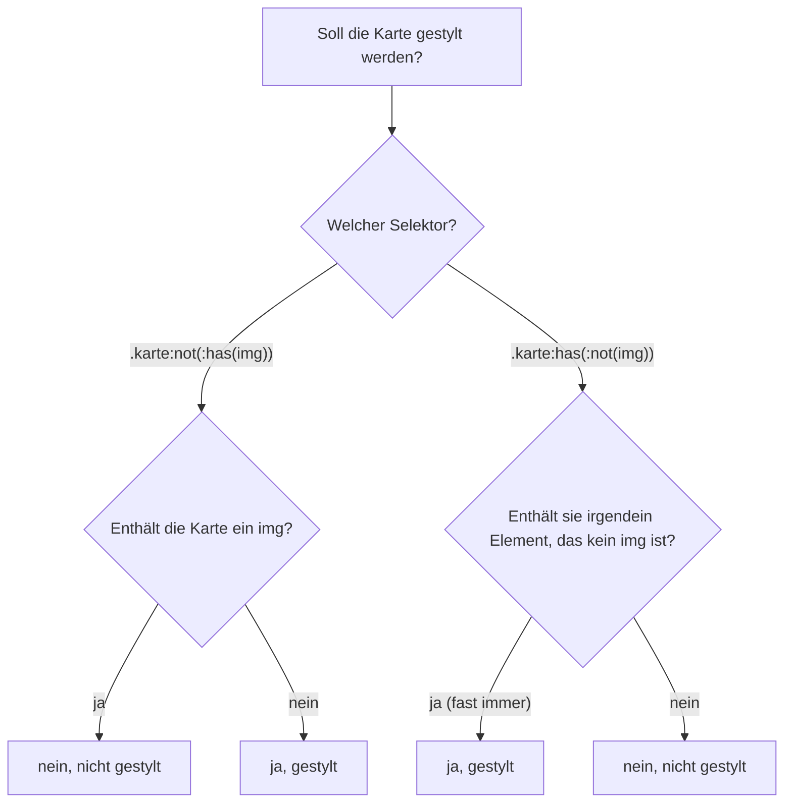

# Elemente anhand ihres Inhalts auswählen

## Ziel

Ein Element soll anders aussehen, je nachdem **was in ihm steckt**: ob es ein Bild enthält, leer ist, mehr als fünf Einträge hat, auf eine PDF-Datei verlinkt oder vor einem bestimmten Element steht. Früher hat man dafür per JavaScript Klassen wie `has-image` oder `is-empty` gesetzt. Heute geht das meiste direkt in CSS.

## Voraussetzungen

- Grundkenntnisse zu [[selektoren/has|:has()]] und [[selektoren/not-is-where|:not()]].
- Alle Rezepte hier sind Baseline *widely available* (Details unten).

## Getestet mit / Stand

Stand 2026-10-18. Jedes Rezept habe ich mit mindestens einem Beispiel in **Chrome 155** nachgestellt, Firefox und Safari nicht. Die Rezepte stammen aus den unten genannten Quellen oder sind daraus abgeleitet. Eigene Ergänzungen sind als solche gekennzeichnet.

## Vorgehen

Vorab eine Grenze, damit man nicht lange sucht: **CSS kann keinen Text vergleichen.** Einen Selektor wie „Absatz, der das Wort *Achtung* enthält" gibt es nicht. CSS sieht nur die Struktur (welche Elemente wo stehen), Attribute und Zustände. Wer nach Text unterscheiden will, muss das im HTML sichtbar machen, etwa mit einer Klasse oder einem `data-`Attribut. (Eigene Einordnung; in keiner der Quellen ausdrücklich so formuliert.)

### 1. Auf ein enthaltenes Element reagieren

Der Grundfall für `:has()`: Der Container wird gestylt, wenn ein bestimmtes Kind darin steckt.

```css
.karte:has(img)        { grid-template-rows: 12rem auto; }  /* mit Bild */
.karte:not(:has(img))  { padding-block-start: 2rem; }       /* ohne Bild */
```

<a href="beispiele/inhalt-01-not-has-gegen-has-not.htm" target="_blank" rel="noopener">↗ Beispiel in neuem Tab öffnen</a>

Wichtig ist die Reihenfolge von `:not()` und `:has()`. Die beiden Varianten klingen ähnlich, bedeuten aber etwas völlig anderes:[^polypane]

| Selektor | Bedeutung | Trifft auf |
| --- | --- | --- |
| `.karte:not(:has(img))` | Karte, die **kein** Bild enthält | nur Karten ohne Bild |
| `.karte:has(:not(img))` | Karte, die **irgendein** Element enthält, das kein Bild ist | praktisch jede Karte mit Text |

Die zweite Variante ist fast immer ein Versehen. Am besten liest man solche Selektoren von innen nach außen: `:not(img)` heißt „irgendein Element außer `img`“, und so eins hat fast jede Karte.



### 2. UND und ODER verknüpfen

Mehrere `:has()` hintereinander bedeuten „und", eine Liste innerhalb eines `:has()` bedeutet „oder":[^shadeed]

```css
.regal:has(.buch-lila):has(.buch-gelb) { … }  /* lila UND gelb */
.regal:has(.buch-lila, .buch-gelb)     { … }  /* lila ODER gelb */
```

<a href="beispiele/inhalt-02-und-oder.htm" target="_blank" rel="noopener">↗ Beispiel in neuem Tab öffnen</a>

### 3. Nach Attributen unterscheiden

Attributselektoren gibt es schon lange, richtig nützlich werden sie aber erst zusammen mit `:has()`. Die Varianten:[^mdn-attr]

| Selektor | trifft, wenn der Attributwert … |
| --- | --- |
| `[attr]` | vorhanden ist (egal welcher Wert) |
| `[attr="x"]` | genau `x` ist |
| `[attr^="x"]` | mit `x` beginnt |
| `[attr$="x"]` | mit `x` endet |
| `[attr*="x"]` | `x` irgendwo enthält |
| `[attr~="x"]` | in einer Leerzeichen-getrennten Liste das Wort `x` enthält |
| `[attr\|="x"]` | genau `x` ist oder mit `x-` beginnt (z. B. Sprachcodes) |
| `[attr$="x" i]` | … und dabei Groß-/Kleinschreibung ignoriert |

Praktische Beispiele:

```css
a[href$=".pdf" i]::after   { content: " (PDF)"; }
a[href^="mailto:"]         { … }
a[download]                { … }  /* Download-Link */

/* Container reagiert auf den Link darin */
.datei:has(a[href$=".pdf" i]) { --icon: url(pdf.svg); }
```

<a href="beispiele/inhalt-03-attribute.htm" target="_blank" rel="noopener">↗ Beispiel in neuem Tab öffnen</a>

Das letzte Muster stammt aus Ahmad Shadeeds Guide: Man erkennt den Dateityp am Link und leitet daraus das Icon des Containers ab.[^shadeed]

### 4. Leere Elemente erkennen

`:empty` trifft Elemente ohne jedes Kind. Aber Vorsicht: **Auch ein Leerzeichen oder ein Zeilenumbruch zählt als Inhalt.** Nur Kommentare zählen nicht.[^mdn-empty]

```html
<div class="ergebnis"></div>               <!-- :empty trifft -->
<div class="ergebnis"><!-- leer --></div>  <!-- :empty trifft -->
<div class="ergebnis"> </div>              <!-- :empty trifft NICHT -->
```

<a href="beispiele/inhalt-04-empty.htm" target="_blank" rel="noopener">↗ Beispiel in neuem Tab öffnen</a>

Selectors Level 4 sollte das ändern, sodass reine Leerzeichen nicht mehr zählen. Laut MDN setzt das aber noch kein Browser um,[^mdn-empty] und in Chrome 155 zählt ein Leerzeichen tatsächlich noch als Inhalt. In der Praxis heißt das: Template-Engines so einstellen, dass leere Container wirklich leer ausgegeben werden.

Zusammen mit `:has()` lässt sich ein ganzer Abschnitt in einen „Noch nichts da"-Zustand schalten:[^shadeed]

```css
.abschnitt:has(.abschnitt-inhalt:empty) {
  display: grid;
  place-content: center;
  min-block-size: 10rem;
}
```

### 5. Nach Anzahl der Kinder unterscheiden (Quantity Queries)

Die Technik ist älter als `:has()`. Shadeed verweist dafür auf einen Artikel von Heydon Pickering bei A List Apart. Sie funktioniert über `:nth-last-child()`: `li:nth-last-child(n + 5)` trifft ein `li`, nach dem noch mindestens vier weitere kommen. So eins gibt es nur, wenn die Liste mindestens fünf Einträge hat. Früher ließen sich damit nur die Einträge selbst stylen. Mit `:has()` reagiert der **Container**:[^shadeed]

```css
.galerie {
  --spalte: 300px;
  display: grid;
  grid-template-columns: repeat(auto-fit, minmax(var(--spalte), 1fr));
}
.galerie:has(> :nth-last-child(n + 5)) { --spalte: 200px; }  /* ab 5 Einträgen */
.galerie:has(> :nth-last-child(n + 9)) { --spalte: 130px; }  /* ab 9 Einträgen */
```

<a href="beispiele/inhalt-05-quantity-queries.htm" target="_blank" rel="noopener">↗ Beispiel in neuem Tab öffnen</a>

Weitere Varianten (eigene Ableitungen nach demselben Prinzip):

```css
.liste:has(> :only-child)                       { … }  /* genau ein Eintrag */
.liste:has(> :nth-child(3):last-child)          { … }  /* genau drei */
.liste:not(:has(> :nth-child(4)))               { … }  /* höchstens drei */
```

### 6. Nur bestimmte Kinder mitzählen

`:nth-child()` zählt normalerweise alle Geschwister. Mit `of <selector>` zählt es nur die, die zum Selektor passen.[^mdn-nth] Der Klassiker: Zebrastreifen in Tabellen, bei denen ausgeblendete Zeilen das Muster nicht durcheinanderbringen.

```css
tbody tr:nth-child(even of :not([hidden])) { background: whitesmoke; }
```

<a href="beispiele/inhalt-06-nth-child-of.htm" target="_blank" rel="noopener">↗ Beispiel in neuem Tab öffnen</a>

Ohne `of` würde eine versteckte Zeile mitgezählt, und zwei sichtbare Zeilen gleicher Farbe stünden direkt untereinander.

Der Unterschied zu einem vorangestellten Selektor ist klein, aber wichtig: `li:nth-child(-n + 3 of .wichtig)` trifft die ersten drei `.wichtig`-Einträge. `li.wichtig:nth-child(-n + 3)` trifft dagegen nur `.wichtig`-Einträge, die zufällig auf Position 1 bis 3 stehen.[^mdn-nth]

### 7. Vorherige Geschwister auswählen

CSS konnte lange nur „nach vorn" schauen: `+` und `~` treffen Elemente, die **nach** einem anderen kommen. Mit `:has()` geht es auch rückwärts:[^ahlin]

```css
.box:has(+ .kreis)         { … }  /* direkt vor dem Kreis */
.box:has(+ * + .kreis)     { … }  /* zwei Positionen davor */
.box:has(~ .kreis)         { … }  /* alle Boxen irgendwo vor dem Kreis */
.box:has(~ * + .kreis)     { … }  /* alle davor außer der direkt davor */
```

Ein Alltagsbeispiel: Eine Überschrift bekommt weniger Abstand nach unten, wenn direkt ein Untertitel folgt.

```css
h2:has(+ .untertitel) { margin-block-end: 0.25rem; }
```

<a href="beispiele/inhalt-07-vorherige-geschwister.htm" target="_blank" rel="noopener">↗ Beispiel in neuem Tab öffnen</a>

### 8. Auf Zustände im Inneren reagieren

Nicht nur Elemente, auch deren **Zustand** lässt sich abfragen:[^shadeed]

```css
.feld:has(input:user-invalid)  { border-color: crimson; }
.karte:has(button:disabled)    { opacity: 0.6; }
.karte:has(a:focus-visible)    { outline: 2px solid; }
```

`:user-invalid` meldet einen Fehler erst, nachdem jemand mit dem Feld etwas gemacht hat. `:invalid` dagegen schlägt schon beim Laden der leeren Seite an. Mehr dazu in [[komponenten/formularfehler|Formularfehler erst nach der Eingabe anzeigen]].

## Warum funktioniert das?

`:has()` prüft die Bedingung **vom Element aus**, an dem es hängt. Ohne Kombinator sucht es unter den Nachfahren, mit `>` nur unter den direkten Kindern, mit `+` und `~` unter den nachfolgenden Geschwistern. Gestylt wird aber das äußere Element. Deshalb wirkt es mal wie ein „Parent Selector“, mal wie ein „Previous Sibling Selector“. Technisch ist es beide Male dieselbe Pseudoklasse.[^mdn-has]

## Fallstricke

- **`:has(:not(…))` statt `:not(:has(…))`:** der häufigste Fehler, siehe Schritt 1.
- **`:empty` und Leerzeichen:** siehe Schritt 4.
- **Kein Text-Matching:** siehe oben. Das gilt auch für `[attr*="…"]`, das nur Attributwerte vergleicht, nicht den sichtbaren Text.
- **Performance:** MDN rät, `:has()` nicht an sehr breite Elemente wie `body`, `:root` oder `*` zu hängen und die Bedingung innen eng zu fassen (`>` oder `+` statt bloßer Nachfahren). Sonst muss der Browser bei jeder DOM-Änderung große Teilbäume neu prüfen.[^mdn-has]
- **Keine Schachtelung:** `:has()` darf nicht in `:has()` stehen, und Pseudoelemente sind darin nicht erlaubt.[^mdn-has] Chrome 155 verwirft solche Regeln komplett.
- **Lesbarkeit:** Eine Regel, die weit oben ansetzt und auf etwas tief Verschachteltes reagiert, findet man beim Debuggen schwer. Lieber das nächstliegende sinnvolle Element als Anker nehmen. (Eigene Einordnung.)

### Browsersupport

Alle Bausteine sind laut `web-features` 3.43.0 (abgefragt 2026-10-18) Baseline *widely available*:

| Feature | widely available seit |
| --- | --- |
| `:has()` | 2026-06-19 |
| `:nth-child(… of S)` | 2025-11-09 |
| `:user-valid` / `:user-invalid` | 2026-05-02 |
| `:focus-visible` | 2024-09-14 |
| `:empty` | 2018-01-29 |

Attributselektoren sind seit CSS 2 Standard; für sie nennt `web-features` kein eigenes Feature, darum steht hier kein Datum.

## Siehe auch

- [[selektoren/has|CSS-Pseudoklasse has()]]
- [[selektoren/not-is-where|CSS-Pseudoklassen not(), is() und where()]]
- [[komponenten/klickbare-karte|Ganze Karte klickbar machen]]
- [[grundlagen/variablen|CSS Custom Properties]] — für die Variablen in den Quantity Queries

## Quellen

- [[quellen/artikel/has-shadeed|CSS has() Interactive Guide (Ahmad Shadeed)]] — UND/ODER, Quantity Queries, leere Abschnitte, Dateityp-Icons, Formularzustände
- [[quellen/artikel/has-not-polypane|Decoding CSS Selectors – has(not) vs not(has) (Polypane)]] — Unterschied der beiden Verschachtelungen
- [[quellen/artikel/previous-sibling-ahlin|Selecting previous siblings with CSS has() (Tobias Ahlin)]] — vorherige Geschwister
- [[quellen/artikel/has-mdn|has() Pseudoklasse (MDN)]] — Grenzen und Performance
- [[quellen/artikel/empty-mdn|empty Pseudoklasse (MDN)]] — Leerzeichen zählen als Inhalt
- [[quellen/artikel/nth-child-mdn|nth-child() Pseudoklasse (MDN)]] — `of <selector>`
- [[quellen/artikel/attributselektoren-mdn|Attributselektoren (MDN)]] — Operatoren und `i`-Flag

Eigene Ergänzungen: die Grenze „kein Text-Matching“, die Varianten „genau ein/drei, höchstens drei“ in Schritt 5, das Überschriften-Beispiel in Schritt 7 und der Satz zu `:user-invalid` und `:invalid`. Das Entscheidungsdiagramm in Schritt 1 fasst die Polypane-Erklärung zusammen.

[^polypane]: [[quellen/artikel/has-not-polypane|Decoding CSS Selectors – has(not) vs not(has) (Polypane)]], Abschnitt „Working from the inside out", 2025-02-17.
[^shadeed]: [[quellen/artikel/has-shadeed|CSS has() Interactive Guide (Ahmad Shadeed)]], Abschnitte „Logical operators", „File download", „Section empty state", „Quantity queries", „Input states", 2024-02-23.
[^mdn-attr]: [[quellen/artikel/attributselektoren-mdn|Attributselektoren (MDN)]], Abschnitt „Syntax", Stand 2026-09-04.
[^mdn-empty]: [[quellen/artikel/empty-mdn|empty Pseudoklasse (MDN)]], Einleitung und Hinweis zu Selectors Level 4, Stand 2026-07-08.
[^mdn-nth]: [[quellen/artikel/nth-child-mdn|nth-child() Pseudoklasse (MDN)]], Abschnitte „The of <selector> syntax" und „Using of selector to fix striped tables", Stand 2026-07-17.
[^ahlin]: [[quellen/artikel/previous-sibling-ahlin|Selecting previous siblings with CSS has() (Tobias Ahlin)]], datiert „09/03/2023“ (Tag/Monat-Reihenfolge unklar).
[^mdn-has]: [[quellen/artikel/has-mdn|has() Pseudoklasse (MDN)]], Abschnitte „Description" und „Performance considerations", Stand 2026-08-11.
