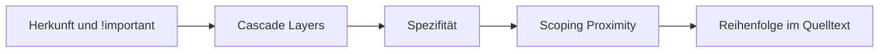

# CSS @scope

## Kurz erklärt

`@scope` begrenzt, **wo** Selektoren greifen dürfen. Man nennt einen Startpunkt im DOM (Scope Root) und optional eine Grenze (Scope Limit). Die Regeln darin treffen nur Elemente dazwischen.[^mdn]

```css
@scope (.artikel) to (figure) {
  img { border: 5px solid; }
}
```

<a href="beispiele/scope-01-donut.htm" target="_blank" rel="noopener">↗ Beispiel in neuem Tab öffnen</a>

Das trifft alle Bilder im `.artikel`, aber keine, die in einer `figure` stecken.

## Hintergrund

Wer ein ganz bestimmtes Element treffen will, hat zwei schlechte Möglichkeiten:[^bramus]

- Einen langen Selektor wie `.karte > .inhalt > img.hero`. Der ist sehr spezifisch, lässt sich schwer überschreiben und bricht, sobald sich das HTML ändert.
- Einen kurzen wie `img`. Der trifft dann aber alle Bilder auf der Seite.

Bisherige Auswege waren Namenskonventionen wie BEM (`karte__bild--hero`), generierte Klassennamen aus JavaScript-Werkzeugen oder Utility-Klassen direkt im HTML. `@scope` löst das Problem in CSS selbst: kurze Selektoren, die trotzdem nur in einem Bereich wirken.

## Wichtige Aspekte

### Root und Limit

```css
@scope (.karte) { … }                /* alles in .karte, .karte selbst eingeschlossen */
@scope (.karte) to (.inhalt) { … }   /* .karte bis vor .inhalt */
```

Die zweite Form heißt **Donut Scope**: ein Bereich mit einem Loch darin. Die obere Grenze gehört dazu, die untere nicht. Wer das ändern will, hängt `> *` an: `to (.inhalt > *)` schließt `.inhalt` selbst mit ein, `(.karte > *)` schließt die Karte selbst aus.[^mdn]

Root und Limit dürfen Selektorlisten sein, `@scope (.hero, .teaser) to (figure)` legt also zwei Bereiche auf einmal fest.[^mdn]

### :scope – das Root-Element selbst

Innerhalb von `@scope` meint `:scope` das Element, an dem der Bereich beginnt:[^mdn]

```css
@scope (.karte) {
  :scope { padding: 1rem; border: 1px solid; }   /* die Karte selbst */
  img    { border-radius: 0.5rem; }              /* Bilder darin */
}
```

Aus dem Bereich heraus kommt man nicht. MDN nennt `:scope + p` deshalb ungültig.[^mdn] In Chrome 155 wird die Regel zwar eingelesen, trifft aber nichts.

### Direkt im HTML

Ohne Klammerangabe in einem `<style>`-Element gilt `@scope` für das Elternelement des `<style>`:[^mdn]

```html
<div class="karte">
  <style>
    @scope { img { border-radius: 0.5rem; } }
  </style>
  
</div>
```

<a href="beispiele/scope-04-inline-style.htm" target="_blank" rel="noopener">↗ Beispiel in neuem Tab öffnen</a>

Das ist praktisch für Komponenten, die ihr CSS gleich mitbringen, etwa aus einem Template.

### Spezifität

Der Selektor in der Klammer zählt nicht mit. In `@scope (#sidebar) { img { … } }` hat `img` weiterhin nur die Spezifität eines Elements (0-0-1).[^bramus]

- **Selektoren ohne Präfix und `&`** zählen laut MDN so, als stünde `:where(:scope)` davor, also gar nicht.[^mdn]
- **`:scope`** zählt wie eine Klasse (0-1-0).[^mdn]

Zu `&` gibt es einen Widerspruch in den Quellen: Der Chrome-Artikel von 2023 schreibt, `&` werde zu `:is(<Root-Selektor>)` und übernehme dessen Spezifität, bei `@scope (#sidebar)` also die einer ID.[^bramus] MDN warnt, dass das je nach Browser und Version unterschiedlich ist.[^mdn] **In Chrome 155 zählt `&` nicht mit**: `@scope (#x) { & p { … } }` verliert gegen `.x p`. Der Chrome-Artikel ist in diesem Punkt also veraltet. Firefox und Safari habe ich nicht geprüft.

Wer im Scope bewusst mehr Gewicht braucht, schreibt `:scope` aus.

### Scoping Proximity: der nähere Bereich gewinnt

`@scope` bringt ein neues Kriterium in die Kaskade. Wenn zwei Regeln gleich spezifisch sind, gewinnt die, deren Scope Root im DOM **näher** am Element liegt, unabhängig von der Reihenfolge im Stylesheet.[^mdn]

Klassisches Beispiel sind verschachtelte Farbthemen:

```html
<div class="hell">
  <div class="dunkel">
    <div class="hell">
      <p>Soll dunkel auf hell sein</p>
    </div>
  </div>
</div>
```

```css
/* Ohne @scope: .dunkel p steht später und gewinnt – falsch */
.hell p   { color: black; }
.dunkel p { color: white; }

/* Mit @scope: das nächste Theme gewinnt – richtig */
@scope (.hell)   { p { color: black; } }
@scope (.dunkel) { p { color: white; } }
```

<a href="beispiele/scope-02-proximity.htm" target="_blank" rel="noopener">↗ Beispiel in neuem Tab öffnen</a>

Der innere Absatz ist nur eine Ebene von `.hell` entfernt, aber zwei von `.dunkel`. Also gilt Schwarz.

Die Proximity steht in der Rangfolge nach `!important`, Cascade Layers und Spezifität und vor der Reihenfolge im Quelltext.[^mdn][^bramus]



### Kein Schutzwall gegen Vererbung

`@scope` begrenzt, welche Elemente die **Selektoren** treffen. Es verhindert nicht, dass sich Werte vererben. Setzt man `color` am Scope Root, erbt auch das „Loch“ im Donut diese Farbe.[^mdn][^bramus]

```css
@scope (.karte) to (.inhalt) {
  :scope { color: hotpink; }   /* .inhalt und alles darin wird trotzdem pink */
}
```

<a href="beispiele/scope-03-vererbung.htm" target="_blank" rel="noopener">↗ Beispiel in neuem Tab öffnen</a>

Wer das Loch wirklich abschirmen will, muss dort die vererbten Eigenschaften selbst wieder setzen.

## Beispiele

Komponente mit eigenem Inhaltsbereich, in den fremdes HTML kommt (etwa aus einem CMS):

```css
@scope (.karte) to (.karte-inhalt) {
  :scope { display: grid; gap: 1rem; }
  h2     { font-size: 1.25rem; }
  a      { color: var(--akzent); }
}
```

Überschriften und Links in `.karte-inhalt` bleiben unberührt, egal wie das HTML dort aussieht.

## Eigene Notizen / Einordnung

`@scope` ersetzt vor allem **Namenskonventionen**: Statt `karte__titel` schreibt man `h2` im Scope der Karte. Ob das lesbarer ist, hängt vom Projekt ab. Bei Komponenten mit fremdem Inhalt, wie im Beispiel oben, ist das Donut-Limit ein echter Gewinn, den es vorher in CSS nicht gab.

Abgrenzung zu verwandten Werkzeugen:

- [[selektoren/nesting|CSS-Nesting]] schreibt Selektoren kürzer, **begrenzt** aber nichts. `.karte { img { … } }` trifft auch Bilder in verschachtelten Unterkomponenten.
- Cascade Layers (`@layer`) regeln, welche **Gruppe** von Regeln gewinnt. `@scope` regelt, **wo** Regeln greifen. Beides lässt sich kombinieren.
- `:where()` (siehe [[selektoren/not-is-where|CSS-Pseudoklassen not(), is() und where()]]) macht Selektoren gewichtslos. Innerhalb von `@scope` ist das bei Selektoren ohne Präfix ohnehin der Fall.

**Zurückhaltung beim Einsatz:** `@scope` ist erst seit März 2026 in allen aktuellen Browsern verfügbar. Ältere Browser ignorieren den ganzen Block, und dann fehlen die Styles komplett. Für wichtige Styles braucht es deshalb vorerst eine Grundversion außerhalb von `@scope`.

### Browsersupport

Laut `web-features` 3.43.0 (abgefragt 2026-10-18): Baseline *newly available* seit 2026-03-24 (Chrome/Edge 143, Firefox 146, Safari 26.4). *Widely available* wird es demnach frühestens im September 2028.

## Siehe auch

- [[selektoren/nesting|CSS-Nesting]]
- [[selektoren/not-is-where|CSS-Pseudoklassen not(), is() und where()]]
- [[grundlagen/container-queries|Container Queries]] – ebenfalls ein Werkzeug für Komponenten

## Quellen

- [[quellen/artikel/scope-mdn|scope At-Regel (MDN)]] — Syntax, Donut Scope, `:scope`, Spezifität, Proximity, Vererbung
- [[quellen/artikel/scope-chrome|Limit the reach of your selectors with the CSS scope at-rule (Chrome for Developers)]] — Motivation, `:scope` gegen `&`, Rangfolge in der Kaskade

Eigene Ergänzungen: der Browsertest zur Spezifität von `&`, das Kaskaden-Diagramm (aus den Angaben beider Quellen), das CMS-Beispiel, die Abgrenzung zu Nesting, Layern und `:where()` sowie der Hinweis zum Fallback. Alle Codebeispiele dieser Notiz habe ich am 2026-10-18 in Chrome 155 nachgestellt, Firefox und Safari nicht.

[^mdn]: [[quellen/artikel/scope-mdn|scope At-Regel (MDN)]], Abschnitte „Description“, „:scope pseudo-class within @scope blocks“, „Specificity in @scope“, „How @scope conflicts are resolved“, Stand 2026-04-20.
[^bramus]: [[quellen/artikel/scope-chrome|Limit the reach of your selectors with the CSS scope at-rule (Chrome for Developers)]], Abschnitte „Introducing @scope“, „@scope and specificity“, „@scope in the cascade“, „Selector isolation, not style isolation“, 2023-10-04.
