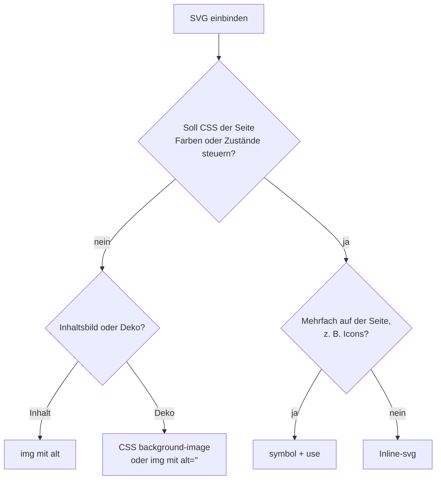

# SVG-Code verstehen

## Kurz erklärt

SVG ist eine Vektorgrafik, die als Text vorliegt: XML mit Elementen für Formen, Linien und Text. Der Browser zeichnet sie in jeder Größe scharf. Weil es Code ist, kann man SVG lesen, von Hand anpassen und, wenn es direkt im HTML steht, mit CSS gestalten.

```html
<svg viewBox="0 0 24 24" width="24" height="24">
  <circle cx="12" cy="12" r="10" fill="none" stroke="currentColor" stroke-width="2"/>
  <path d="M8 12 L11 15 L16 9" fill="none" stroke="currentColor" stroke-width="2"/>
</svg>
```

Das ist ein Kreis mit Häkchen: ein `circle` und ein `path` mit drei Punkten.

## Hintergrund

Die meisten SVGs entstehen in Grafikprogrammen wie Affinity, Illustrator oder Figma und werden exportiert. Pfade von Hand zu schreiben, empfiehlt nicht einmal MDN.[^mdn-paths] Lesen können sollte man den Code trotzdem: um Exporte aufzuräumen, Farben auf CSS umzustellen, Fehler zu finden oder kleine Icons anzupassen.

## Wichtige Aspekte

### Koordinatensystem

Der Ursprung (0,0) liegt **oben links**. x wächst nach rechts, y wächst **nach unten**, also andersherum als im Matheunterricht, aber genau wie bei HTML.[^mdn-pos]

Zahlen ohne Einheit sind **User Units**. Ohne `viewBox` ist eine User Unit ein CSS-Pixel.[^mdn-pos]

### viewBox: das innere Koordinatensystem

`viewBox="min-x min-y breite höhe"` legt fest, welcher Ausschnitt der Zeichenfläche auf die tatsächliche Größe des SVG abgebildet wird.[^mdn-viewbox]

```html
<svg width="200" height="200" viewBox="0 0 100 100">
  <rect x="10" y="10" width="40" height="40"/>
</svg>
```

<a href="beispiele/svg-01-viewbox.htm" target="_blank" rel="noopener">↗ Beispiel in neuem Tab öffnen</a>

Das SVG ist 200 × 200 Pixel groß, innen wird aber mit 0 bis 100 gerechnet. Jede User Unit wird also zu 2 Pixeln, und das Rechteck erscheint 80 × 80 Pixel groß.[^mdn-pos] (In Chrome 155 nachgemessen.)

Genau das macht SVG skalierbar: Die Zeichnung rechnet in ihrem eigenen System, die Größe bestimmt man von außen.

### preserveAspectRatio: wenn das Format nicht passt

Ist der Platz anders proportioniert als die `viewBox`, entscheidet `preserveAspectRatio`, was passiert.[^mdn-par]

| Wert | Wirkung | entspricht ungefähr |
| --- | --- | --- |
| `xMidYMid meet` (Standard) | ganze Grafik sichtbar, mittig, eventuell Rand | `object-fit: contain` |
| `xMidYMid slice` | ganzer Platz bedeckt, Grafik eventuell abgeschnitten | `object-fit: cover` |
| `none` | Grafik wird verzerrt, bis sie genau passt | `object-fit: fill` |

<a href="beispiele/svg-02-preserveaspectratio.htm" target="_blank" rel="noopener">↗ Beispiel in neuem Tab öffnen</a>

Statt `xMid`/`YMid` gibt es auch `xMin`/`xMax` und `YMin`/`YMax` für die Ausrichtung. Die Vergleiche mit `object-fit` sind meine eigenen.

### Grundformen

| Element | Wichtige Attribute |
| --- | --- |
| `rect` | `x`, `y`, `width`, `height`, `rx`/`ry` für runde Ecken |
| `circle` | `cx`, `cy`, `r` |
| `ellipse` | `cx`, `cy`, `rx`, `ry` |
| `line` | `x1`, `y1`, `x2`, `y2` |
| `polyline` / `polygon` | `points` (offen bzw. geschlossen) |
| `path` | `d` (beliebige Form) |

Quelle: MDN.[^mdn-shapes]

### Pfade lesen

Im Attribut `d` steht eine Folge von Befehlen, jeweils ein Buchstabe mit Zahlen. **Großbuchstaben** meinen absolute Koordinaten, **Kleinbuchstaben** relative, also vom letzten Punkt aus.[^mdn-paths]

| Befehl | Bedeutung |
| --- | --- |
| `M x y` | zum Punkt springen, ohne zu zeichnen |
| `L x y` | Linie zum Punkt |
| `H x` / `V y` | waagerechte bzw. senkrechte Linie |
| `C x1 y1, x2 y2, x y` | kubische Bézierkurve mit zwei Kontrollpunkten |
| `S x2 y2, x y` | Fortsetzung einer Bézierkurve |
| `Q x1 y1, x y` / `T x y` | quadratische Bézierkurve und ihre Fortsetzung |
| `A rx ry drehung groß richtung x y` | Ellipsenbogen |
| `Z` | Pfad zum Startpunkt schließen |

Beispiel: `M 10 10 h 80 v 80 h -80 Z` heißt „bei 10,10 anfangen, 80 nach rechts, 80 nach unten, 80 nach links, zurück zum Start“. Das ergibt ein Quadrat.[^mdn-paths]

<a href="beispiele/svg-03-pfadbefehle.htm" target="_blank" rel="noopener">↗ Beispiel in neuem Tab öffnen</a>

### Gruppieren und wiederverwenden

- `<g>` fasst Elemente zusammen. Styles am `g` werden vererbt.[^soueidan]
- `<defs>` enthält Dinge, die nicht direkt gezeichnet werden, etwa Verläufe.[^soueidan]
- `<symbol>` ist eine Vorlage mit eigener `viewBox`. Es wird selbst nicht gezeichnet, nur über `<use>`.[^mdn-symbol]
- `<use href="#id">` setzt ein Element oder Symbol an anderer Stelle ein. Der Inhalt ist ein Klon in einem versteckten Shadow DOM.[^mdn-use]

Damit baut man Icon-Systeme, siehe [[svg/svg-icons|SVG-Icons barrierefrei einbinden]].

### Einbindung: was CSS erreicht

Wie man ein SVG einbindet, entscheidet, was man damit machen kann:[^mdn-image]

| Einbindung | Seiten-CSS wirkt hinein | Skripte im SVG | Externe Ressourcen im SVG |
| --- | --- | --- | --- |
| Inline `<svg>` im HTML | ja | ja (Teil der Seite) | ja |
| `<svg><use href="datei.svg#id">` | nur über Vererbung | – | – |
| `` | **nein** | nein | nein, nur `data:`-URLs |
| CSS `background-image` | **nein** | nein | nein, nur `data:`-URLs |
| `<object>`, `<iframe>`, `<embed>` | nein (eigenes Dokument) | ja | ja |

Die Spalte „Seiten-CSS“ habe ich aus dem Unterschied zwischen eingebettetem Dokument und Inline-Code abgeleitet und in Chrome 155 für `` geprüft: Eine Regel `circle { fill: red }` auf der Seite färbte das Inline-SVG rot, das SVG im `` nicht. Ein `@media (prefers-color-scheme: dark)` **innerhalb** der SVG-Datei griff dagegen auch im ``, und zwar abhängig von `color-scheme` der Seite bzw. des `` (Details in [[svg/svg-gestalten|SVG mit CSS gestalten]]).

<a href="beispiele/svg-04-einbindung.htm" target="_blank" rel="noopener">↗ Beispiel in neuem Tab öffnen</a>



Das Diagramm ist eigene Einordnung aus der Tabelle oben.

## Beispiele

Ein exportiertes Icon aufräumen (eigenes Beispiel):

```html
<!-- Export aus dem Grafikprogramm -->
<svg xmlns="http://www.w3.org/2000/svg" width="48px" height="48px" viewBox="0 0 48 48" version="1.1">
  <title>Created with Sketch</title>
  <g id="Page-1" stroke="none" fill="none">
    <path d="…" fill="#1A1A1A"/>
  </g>
</svg>

<!-- aufgeräumt für Inline-Einsatz -->
<svg viewBox="0 0 48 48" aria-hidden="true">
  <path d="…" fill="currentColor"/>
</svg>
```

- `width`/`height` raus, die Größe kommt aus dem CSS. Aber Vorsicht, siehe Fallstricke.
- Den nutzlosen Titel raus, er wäre sonst der zugängliche Name.[^ohara]
- Leere Gruppen und `version` raus.
- Die feste Farbe durch `currentColor` ersetzen, dann übernimmt das Icon die Textfarbe (siehe [[svg/svg-gestalten|SVG mit CSS gestalten]]).

## Fallstricke

- **Inline-SVG ohne Größe wird riesig.** In Chrome 155 nachgemessen: Ein `<svg viewBox="0 0 24 24">` ohne `width` und `height` wurde in einem 400px breiten Container 400 × 400 groß, ein `<svg>` ganz ohne Angaben 300 × 150. Deshalb immer eine Größe setzen, im HTML oder per CSS (`width: 1em; height: 1em`).
- **`viewBox` fehlt.** Ohne `viewBox` skaliert der Inhalt nicht mit, wenn man die Größe ändert. Dann ist nur der Rand größer.
- **y zeigt nach unten.** Wer Koordinaten aus einem Diagramm übernimmt, bei dem y nach oben wächst, bekommt die Grafik auf den Kopf gestellt.
- **Gleiche IDs.** Steht dasselbe SVG zweimal inline auf der Seite, gibt es auch jede `id` (Verläufe, Clip-Pfade) zweimal. Verweise wie `fill="url(#verlauf)"` treffen dann womöglich das falsche Element. (Eigene Ableitung, nicht getestet.)

### Browsersupport

Laut `web-features` 3.43.0 (abgefragt 2026-10-18): SVG insgesamt Baseline *widely available* seit 2022-07-15, `currentColor` seit 2018-01-29. `<use>`, `<symbol>` und `<title>` nennt MDN „available across browsers since July 2015“.

## Siehe auch

- [[svg/svg-gestalten|SVG mit CSS gestalten]]
- [[svg/svg-icons|SVG-Icons barrierefrei einbinden]]

## Quellen

- [[quellen/artikel/svg-koordinaten-mdn|SVG-Koordinatensystem (MDN)]] — Ursprung, User Units, Wirkung von `viewBox`
- [[quellen/artikel/viewbox-mdn|viewBox Attribut (MDN)]] und [[quellen/artikel/preserveaspectratio-mdn|preserveAspectRatio Attribut (MDN)]] — Skalierung und Einpassen
- [[quellen/artikel/svg-grundformen-mdn|SVG-Grundformen (MDN)]] und [[quellen/artikel/svg-pfade-mdn|SVG-Pfade (MDN)]] — Formen und Pfadbefehle
- [[quellen/artikel/symbol-mdn|symbol-Element (MDN)]] und [[quellen/artikel/use-mdn|use-Element (MDN)]] — Wiederverwendung
- [[quellen/artikel/svg-als-bild-mdn|SVG als Bild (MDN)]] — Einbindungsarten und Einschränkungen
- [[quellen/artikel/svg-use-soueidan|Styling SVG use Content with CSS (Sara Soueidan)]] — `g`, `defs`, `symbol`, `use` im Überblick
- [[quellen/artikel/svg-a11y-ohara|Contextually Marking up accessible images and SVGs (Scott O'Hara)]] — exportierte Titel

Eigene Ergänzungen: die Einbindungstabelle in dieser Form, das Diagramm, das Aufräumbeispiel, die Vergleiche mit `object-fit` und die Fallstricke. Die Messungen zu `viewBox`, zur Größe ohne Angaben und zum Seiten-CSS im `` habe ich am 2026-10-18 in Chrome 155 gemacht, Firefox und Safari nicht.

[^mdn-pos]: [[quellen/artikel/svg-koordinaten-mdn|SVG-Koordinatensystem (MDN)]], Abschnitte „The grid“ und „Pixels, user units, and the SVG user coordinate system“, Stand 2026-07-24.
[^mdn-viewbox]: [[quellen/artikel/viewbox-mdn|viewBox Attribut (MDN)]], Einleitung, Stand 2026-04-07.
[^mdn-par]: [[quellen/artikel/preserveaspectratio-mdn|preserveAspectRatio Attribut (MDN)]], Abschnitt „Syntax“, Stand 2026-04-07.
[^mdn-shapes]: [[quellen/artikel/svg-grundformen-mdn|SVG-Grundformen (MDN)]], Stand 2026-08-27.
[^mdn-paths]: [[quellen/artikel/svg-pfade-mdn|SVG-Pfade (MDN)]], Einleitung, „Line commands“, „Curve commands“, Stand 2026-08-31.
[^mdn-symbol]: [[quellen/artikel/symbol-mdn|symbol-Element (MDN)]], Einleitung, Stand 2025-07-01.
[^mdn-use]: [[quellen/artikel/use-mdn|use-Element (MDN)]], Einleitung, Stand 2026-08-14.
[^mdn-image]: [[quellen/artikel/svg-als-bild-mdn|SVG als Bild (MDN)]], Abschnitte „Features supporting SVG“ und „Restrictions“, Stand 2025-05-13.
[^soueidan]: [[quellen/artikel/svg-use-soueidan|Styling SVG use Content with CSS (Sara Soueidan)]], Abschnitt „Quick Overview of SVG Structuring, Grouping and Referencing“, 2015-07-16.
[^ohara]: [[quellen/artikel/svg-a11y-ohara|Contextually Marking up accessible images and SVGs (Scott O'Hara)]], Abschnitt „SVGs that convey information“, 2019-05-22.
