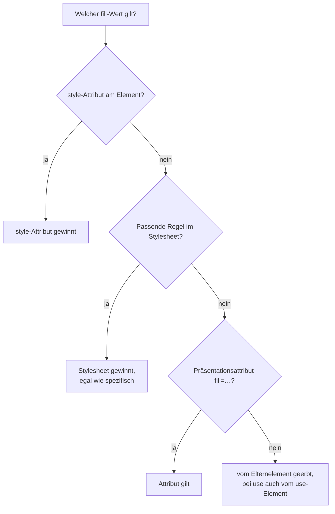

# SVG mit CSS gestalten

## Ziel

Farben, Linien und Zustände eines SVG per CSS steuern statt im SVG-Code: Icons sollen die Textfarbe übernehmen, beim Hover reagieren, im Dark Mode passen und sich bei Bedarf animieren lassen.

## Voraussetzungen

- Das SVG steht **inline** im HTML oder wird über `<use>` eingesetzt. In `` oder als `background-image` erreicht das CSS der Seite das SVG nicht (siehe [[svg/svg-code|SVG-Code verstehen]]).
- Grundbegriffe wie `viewBox` und `path`: [[svg/svg-code|SVG-Code verstehen]].

## Getestet mit / Stand

Stand 2026-10-18. Alle Codebeispiele habe ich in **Chrome 155** nachgestellt, Firefox und Safari nicht.

## Vorgehen

### 1. Die wichtigsten Eigenschaften

SVG-Formen haben eigene CSS-Eigenschaften:[^mdn-fill]

| Eigenschaft | Wirkung |
| --- | --- |
| `fill` | Farbe der Fläche (`none` für keine) |
| `stroke` | Farbe der Kontur |
| `stroke-width` | Strichstärke. Die Kontur liegt mittig auf dem Pfad, halb innen und halb außen |
| `stroke-linecap` | Linienenden: `butt`, `round`, `square` |
| `stroke-linejoin` | Ecken: `miter`, `round`, `bevel` |
| `stroke-dasharray`, `stroke-dashoffset` | Strichmuster und wo es beginnt |
| `fill-opacity`, `stroke-opacity` | Deckkraft getrennt für Fläche und Kontur |
| `paint-order` | ob Kontur oder Fläche oben liegt |

```css
.diagramm path {
  fill: none;
  stroke: var(--akzent);
  stroke-width: 2;
  stroke-linecap: round;
  stroke-linejoin: round;
}
```

### 2. Verstehen, warum CSS die Attribute schlägt

Ein exportiertes SVG hat oft Farben als Attribute: `<path fill="#1A1A1A">`. Solche **Präsentationsattribute** sehen stark aus, sind in der Kaskade aber das Schwächste überhaupt: **Jede CSS-Regel gewinnt gegen sie**, egal wie unspezifisch. Präsentationsattribute schlagen nur vererbte Werte.[^soueidan]

In Chrome 155 nachgeprüft:

| Situation | Ergebnis |
| --- | --- |
| `fill="red"` und CSS `.icon rect { fill: blue }` | blau |
| `fill="red"` und CSS `:where(.icon) rect { fill: blue }` (Spezifität 0) | blau |
| `style="fill: green"` und CSS `.icon rect { fill: blue }` | grün (Inline-Style schlägt das Stylesheet) |

<a href="beispiele/svgcss-01-kaskade.htm" target="_blank" rel="noopener">↗ Beispiel in neuem Tab öffnen</a>

Soueidan rät, die Attribute im SVG **nicht** zu löschen: Sie sind ein guter Fallback, falls das CSS einmal nicht lädt.[^soueidan]

### 3. Farbe von außen übernehmen: currentColor

`currentColor` steht für den aktuellen Wert von `color`. Setzt man im SVG `fill="currentColor"`, übernimmt das Icon automatisch die Textfarbe seiner Umgebung:

```html
<button class="loeschen">
  <svg viewBox="0 0 20 20" aria-hidden="true">
    <path d="…" fill="currentColor"/>
  </svg>
  Löschen
</button>
```

```css
.loeschen { color: crimson; }
.loeschen:hover { color: darkred; }   /* das Icon färbt sich mit */
```

<a href="beispiele/svgcss-02-currentcolor.htm" target="_blank" rel="noopener">↗ Beispiel in neuem Tab öffnen</a>

Das ist der einfachste Weg, Icons zu Hover-Zuständen, Dark Mode und Forced-Colors-Modus passend zu halten. In Chrome 155 übernahm das Icon die Farbe des Buttons. (Die Begründung mit dem Forced-Colors-Modus ist eigene Ableitung, nicht getestet.)

### 4. Inhalte von use stylen

Bei `<use>` liegt der eingesetzte Inhalt in einem versteckten Shadow DOM. Das hat Folgen:[^soueidan][^mdn-use]

```html
<svg style="display: none">
  <symbol id="stern" viewBox="0 0 24 24">
    <path d="…"/>
  </symbol>
</svg>

<svg class="icon"><use href="#stern"/></svg>
```

| Ansatz | Wirkt? (Chrome 155) |
| --- | --- |
| Selektor von außen: `.icon path { fill: red }` | **nein** |
| Regel auf das Original: `#stern path { fill: green }` | ja, für alle Kopien gleich |
| Vererbung: `.icon { fill: blue }`, Pfad ohne eigenes `fill` | ja |
| Custom Property: `.icon { --farbe: orange }`, im Original `fill: var(--farbe, black)` | ja |
| `fill="currentColor"` im Original, `.icon { color: … }` | ja |

**Custom Properties** sind der flexibelste Weg, weil sie vererbt werden und damit in den Klon gelangen. MDN empfiehlt sie ausdrücklich für unterschiedlich gestaltete `<use>`-Kopien.[^mdn-css]

```css
#stern path { fill: var(--stern-farbe, currentColor); }

.bewertung .icon       { --stern-farbe: gold; }
.bewertung .icon.leer  { --stern-farbe: lightgray; }
```

**Zwei Farben ohne Custom Properties** (nach Soueidan): Ein Teil bekommt `fill="currentColor"`, der andere gar kein `fill`. Dann steuert man am `<use>`-Container den einen Teil über `fill` und den anderen über `color`.[^soueidan] In Chrome 155 nachgestellt.

```css
.logo { fill: navy; color: orange; }
```

<a href="beispiele/svgcss-03-use-stylen.htm" target="_blank" rel="noopener">↗ Beispiel in neuem Tab öffnen</a>

Funktioniert in Chrome 155 auch: `var()` direkt im Attribut, also `<path fill="var(--farbe, black)">`. In den ausgewerteten Quellen steht das nicht. Ich würde mich deshalb auf die Variante im `style`-Attribut oder im Stylesheet verlassen.

### 5. Zustände: hover und focus

Inline-SVG-Elemente reagieren auf `:hover` wie HTML-Elemente:[^mdn-fill]

```css
.karte:hover .pfeil { stroke: var(--akzent); }
```

Bei `<use>` ist es heikler: MDN schreibt, dass „nur wenige Browser“ `:hover` an Elementen im Klon unterstützen.[^mdn-css] In Chrome 155 reagierte `#symbol path:hover` im Klon. Robuster ist es, den Zustand am umgebenden Element abzufragen und per Vererbung oder Custom Property weiterzugeben, also `.button:hover .icon { --farbe: … }`.

### 6. Geometrie per CSS ändern

Seit SVG 2 sind viele Geometrie-Attribute auch CSS-Eigenschaften (Geometry Properties): `x`, `y`, `width`, `height`, `cx`, `cy`, `r`, `rx`, `ry` und `d`.[^mdn-use] In Chrome 155 ließen sich `width`/`height` am `rect`, `r`/`cx` am `circle` und sogar `d: path("M 0 0 L 40 40")` per CSS setzen.

Das MDN-Tutorial „Fills and strokes“ behauptet noch das Gegenteil: `width`, `height` und Pfadbefehle gingen nicht per CSS.[^mdn-fill] Die Referenzseite zu `<use>` nennt sie dagegen ausdrücklich als Geometry Properties.[^mdn-use] Das Tutorial ist hier veraltet, zumindest für Chrome. Wie Firefox und Safari das handhaben, habe ich nicht geprüft.

### 7. Drehen und skalieren: transform-box

Bei SVG-Elementen liegt der Bezugspunkt für `transform` standardmäßig nicht in der Mitte des Elements, sondern beim Ursprung des SVG. Ein `rotate(90deg)` schwenkt die Form deshalb um die obere linke Ecke des SVG herum aus dem Bild. Mit `transform-box: fill-box` bezieht sich die Transformation auf die Form selbst:

```css
.zahnrad {
  transform-box: fill-box;
  transform-origin: center;
}
.zahnrad:hover { rotate: 90deg; }
```

<a href="beispiele/svgcss-04-transform-box.htm" target="_blank" rel="noopener">↗ Beispiel in neuem Tab öffnen</a>

In Chrome 155 nachgemessen: Ohne `transform-box` landete das gedrehte Rechteck links außerhalb des SVG (x = −4), mit `fill-box` drehte es sich an Ort und Stelle. Die Erklärung ist eigene Ableitung aus dem Verhalten, MDN-Seiten zu `transform-box` habe ich nicht ausgewertet.

### 8. Strichstärke beim Skalieren festhalten

Wird ein SVG verzerrt oder stark skaliert, wachsen die Linien mit. `vector-effect: non-scaling-stroke` hält die Strichstärke fest:[^mdn-ve]

```css
.diagramm path { vector-effect: non-scaling-stroke; }
```

<a href="beispiele/svgcss-05-non-scaling-stroke.htm" target="_blank" rel="noopener">↗ Beispiel in neuem Tab öffnen</a>

Nützlich für Diagramme mit `preserveAspectRatio="none"`. In Chrome 155 nachgestellt: Eine Linie mit `stroke-width="1"` in einem stark gestreckten SVG wurde mehrere Pixel dick, mit `non-scaling-stroke` blieb sie 1 Pixel.

### 9. Linie zeichnen lassen

Mit `stroke-dasharray` und `stroke-dashoffset` lässt sich eine Linie so animieren, als würde sie gezeichnet. Mit `pathLength="1"` am Pfad muss man die echte Länge nicht kennen, weil der Browser dann so rechnet, als wäre der Pfad 1 lang:

```html
<path class="zeichnen" pathLength="1" d="…" fill="none" stroke="currentColor"/>
```

```css
@media (prefers-reduced-motion: no-preference) {
  .zeichnen {
    stroke-dasharray: 1;
    stroke-dashoffset: 1;            /* ganz versteckt */
    animation: zeichnen 1.5s ease-out forwards;
  }
}
@keyframes zeichnen {
  to { stroke-dashoffset: 0; }       /* ganz sichtbar */
}
```

<a href="beispiele/svgcss-06-linie-zeichnen.htm" target="_blank" rel="noopener">↗ Beispiel in neuem Tab öffnen</a>

In Chrome 155 nachgestellt: Mit `stroke-dashoffset: 1` ist die Linie unsichtbar, mit `0.5` halb und mit `0` ganz zu sehen. `pathLength` kommt in den ausgewerteten Quellen nicht vor, das Muster ist verbreitete Praxis. Mehr zu Bewegung und Rücksichtnahme: [[animation/barrierearme-animationen|Barrierearme Animationen]].

### 10. Dark Mode

Für Inline-SVG reicht meist `currentColor` oder eine Custom Property, die im Dark Mode umgestellt wird (siehe [[grundlagen/variablen|CSS Custom Properties]]).

Für SVG-Dateien in `` kann das SVG die Einstellung selbst abfragen:

```html
<svg xmlns="http://www.w3.org/2000/svg" viewBox="0 0 20 20">
  <style>
    circle { fill: black; }
    @media (prefers-color-scheme: dark) { circle { fill: white; } }
  </style>
  <circle cx="10" cy="10" r="9"/>
</svg>
```

<a href="beispiele/svgcss-07-dark-mode-img.htm" target="_blank" rel="noopener">↗ Beispiel in neuem Tab öffnen</a>

In Chrome 155 nachgestellt, mit dunklem Systemdesign: Welcher Fall greift, hängt von `color-scheme` am `` ab, das es von der Seite erbt.

| `color-scheme` am `` bzw. auf der Seite | Kreis |
| --- | --- |
| nicht gesetzt oder `light dark` | weiß (folgt dem System) |
| `light` | schwarz |
| `dark` | weiß |

Ein SVG-Bild folgt also der Farbeinstellung der Seite. Setzt ein Theme-Schalter `color-scheme` am Wurzelelement, ziehen die SVG-Bilder mit. Eine Seite, die mit `color-scheme: light` fest hell bleibt, bekommt auch helle SVGs. In den ausgewerteten Quellen steht das nicht, und Firefox und Safari habe ich nicht geprüft.

## Warum funktioniert das?



Präsentationsattribute zählen wie Regeln in einem Stylesheet mit dem niedrigsten möglichen Rang.[^soueidan] Deshalb setzt sich jede echte CSS-Regel durch. Vererbung greift nur, wenn gar nichts gesetzt ist. Darauf beruhen `currentColor`, Custom Properties und das Stylen von `<use>`-Inhalten. Das Diagramm fasst Soueidans Erklärung zusammen und lässt `!important` und Cascade Layers weg.

## Fallstricke

- **SVG in `` lässt sich nicht von außen stylen.** Wer Farben per CSS steuern will, muss inline einbinden oder `<use>` verwenden.
- **Schwarze Flächen nach dem Aufräumen.** Löscht man `fill` im SVG und setzt kein CSS, fällt der Browser auf den Standardwert zurück, und der ist Schwarz.[^soueidan]
- **`fill: none` vergessen.** Linien-Icons (nur Kontur) brauchen ausdrücklich `fill: none`, sonst wird die Fläche schwarz gefüllt.
- **Konturen werden abgeschnitten.** Die Kontur liegt halb außerhalb des Pfads. Reicht der Pfad bis an den Rand der `viewBox`, fehlt die äußere Hälfte. Abhilfe: etwas Luft in der `viewBox` lassen. (Eigene Ableitung aus der mittigen Lage der Kontur.)
- **`stroke-width` mit Einheit.** Die Strichstärke wird in User Units der `viewBox` gerechnet. Bei `viewBox="0 0 24 24"` und 48px Darstellungsgröße wird `stroke-width: 2` zu 4 Pixeln. (Eigene Ableitung, siehe [[svg/svg-code|SVG-Code verstehen]].)
- **Selektoren erreichen den `<use>`-Klon nicht.** Siehe Schritt 4.

### Browsersupport

Laut `web-features` 3.43.0 (abgefragt 2026-10-18):

| Feature | Stand |
| --- | --- |
| SVG, `currentColor` | Baseline *widely available* |
| `paint-order` | Baseline *widely available* seit 2026-09-22 |
| `transform-box` | Baseline *newly available* seit 2024-04-16 |
| `vector-effect` | laut MDN-Banner *widely available* („since July 2020“), in `web-features` nicht als eigener Eintrag gefunden |
| `context-fill`/`context-stroke` | *limited*: Chrome 124, Firefox 111, Safari fehlt |

## Siehe auch

- [[svg/svg-code|SVG-Code verstehen]]
- [[svg/svg-icons|SVG-Icons barrierefrei einbinden]]
- [[grundlagen/variablen|CSS Custom Properties]]
- [[animation/transitions-und-keyframes|CSS-Transitions und Keyframe-Animationen]]
- [[animation/barrierearme-animationen|Barrierearme Animationen]]

## Quellen

- [[quellen/artikel/svg-fill-stroke-mdn|SVG Füllung und Kontur (MDN)]] — Eigenschaften, CSS statt Attribute, `:hover`
- [[quellen/artikel/svg-und-css-mdn|SVG und CSS (MDN)]] — Custom Properties für `<use>`, `:hover` im Klon
- [[quellen/artikel/use-mdn|use-Element (MDN)]] — Shadow-Klon, Geometry Properties
- [[quellen/artikel/vector-effect-mdn|vector-effect Attribut (MDN)]] — `non-scaling-stroke`
- [[quellen/artikel/svg-use-soueidan|Styling SVG use Content with CSS (Sara Soueidan)]] — Kaskade, Fallback, `currentColor`, Zwei-Farben-Technik, Custom Properties

Eigene Ergänzungen: die Tests in Chrome 155 (Kaskade, `<use>`-Tabelle, `var()` im Attribut, Geometry Properties, `transform-box`, `non-scaling-stroke`, Strichanimation, Dark Mode im ``), das Diagramm, das Muster mit `pathLength="1"` und die Fallstricke zu `fill: none`, abgeschnittenen Konturen und `stroke-width`.

[^mdn-fill]: [[quellen/artikel/svg-fill-stroke-mdn|SVG Füllung und Kontur (MDN)]], Abschnitte „Fill and Stroke Attributes“ und „Using CSS“, Stand 2026-08-07.
[^mdn-css]: [[quellen/artikel/svg-und-css-mdn|SVG und CSS (MDN)]], Hinweis am Anfang und Abschnitt „Simplified structure“, Stand 2026-08-03.
[^mdn-use]: [[quellen/artikel/use-mdn|use-Element (MDN)]], Abschnitte „Attributes“ und „Usage notes“, Stand 2026-08-14.
[^mdn-ve]: [[quellen/artikel/vector-effect-mdn|vector-effect Attribut (MDN)]], Abschnitt „Usage notes“, Stand 2025-04-03.
[^soueidan]: [[quellen/artikel/svg-use-soueidan|Styling SVG use Content with CSS (Sara Soueidan)]], Abschnitte „The Style Cascade“, „Overriding Presentation Attribute Values From CSS“, „Using the CSS currentColor Variable“ und „Styling <use> Content with CSS Custom Properties“, 2015-07-16.
