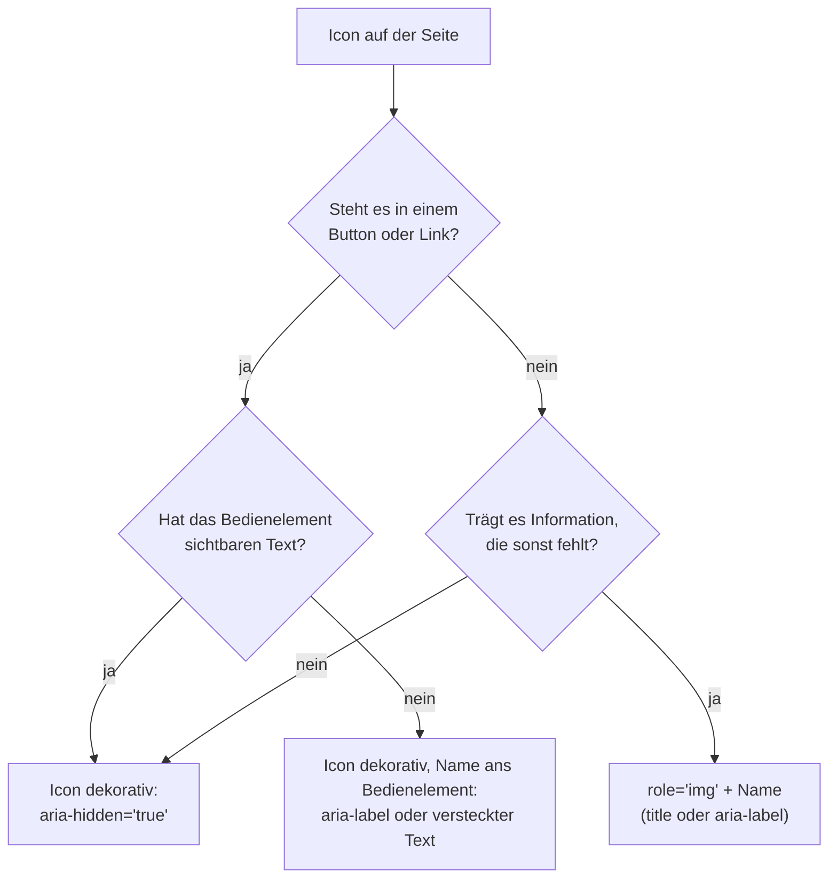

# SVG-Icons barrierefrei einbinden

## Ziel

Eine Sammlung von Icons, die man überall auf der Seite mit einer Zeile einsetzen kann, die sich in Farbe und Größe der Umgebung anpassen und die Screenreader richtig ansagen: als Bild mit Namen, wenn das Icon etwas bedeutet, und gar nicht, wenn es nur schmückt.

## Voraussetzungen

- SVG-Grundlagen: [[svg/svg-code|SVG-Code verstehen]].
- Styling, vor allem `currentColor` und Custom Properties: [[svg/svg-gestalten|SVG mit CSS gestalten]].

## Getestet mit / Stand

Stand 2026-10-18. In **Chrome 155** nachgestellt: Darstellung des Sprites, Größe über `em`, Tab-Reihenfolge. **Nicht getestet:** Screenreader, Firefox, Safari. Die Regeln zur Auszeichnung stammen aus MDN und aus Scott O'Haras Tests von 2019 (aktualisiert 2021) mit VoiceOver, NVDA, JAWS, Narrator und TalkBack.[^ohara] Ob jemand die Muster seitdem mit aktuellen Screenreadern geprüft hat, weiß ich nicht.

## Vorgehen

### 1. Sprite anlegen

Alle Icons stehen einmal als `<symbol>` in einem versteckten SVG, am besten direkt nach dem öffnenden `<body>`:[^mdn-symbol][^soueidan]

```html
<svg style="display: none">
  <symbol id="icon-suche" viewBox="0 0 24 24">
    <circle cx="11" cy="11" r="7" fill="none" stroke="currentColor" stroke-width="2"/>
    <path d="M16 16 L21 21" stroke="currentColor" stroke-width="2"/>
  </symbol>
  <symbol id="icon-schliessen" viewBox="0 0 24 24">
    <path d="M6 6 L18 18 M18 6 L6 18" stroke="currentColor" stroke-width="2"/>
  </symbol>
</svg>
```

- Jedes `<symbol>` bekommt seine eigene `viewBox`, dann skaliert es in jede Größe.[^mdn-symbol]
- Farben als `currentColor`, dann übernimmt das Icon die Textfarbe.
- Keine `<title>`-Elemente in die Symbole. Der Name gehört an die Stelle, an der das Icon eingesetzt wird, weil er dort vom Zusammenhang abhängt. (Eigene Einordnung, gestützt auf O'Hara, der `<use>` aus genau diesem Grund mit `aria-hidden` versieht.[^ohara])

Statt inline kann das Sprite auch eine eigene Datei sein: `<use href="/icons.svg#icon-suche">`. Verweise auf eine fremde Origin können Browser blockieren.[^mdn-use]

### 2. Icon einsetzen und Größe festlegen

```html
<svg class="icon"><use href="#icon-suche"/></svg>
```

```css
.icon {
  width: 1em;
  height: 1em;
  vertical-align: -0.125em;   /* optisch auf die Grundlinie setzen */
  flex-shrink: 0;
}
```

<a href="beispiele/svgicons-01-sprite-groesse.htm" target="_blank" rel="noopener">↗ Beispiel in neuem Tab öffnen</a>

Mit `1em` wächst das Icon mit der Schriftgröße, auch beim Zoomen. In Chrome 155 war es bei 16px Schrift genau 16 × 16 groß. **Ohne Größenangabe** wird ein Inline-SVG dagegen 300 × 150 groß oder so breit wie sein Container (siehe [[svg/svg-code|SVG-Code verstehen]]). `vertical-align` und `flex-shrink` sind eigene Ergänzungen.

### 3. Entscheiden: informativ oder dekorativ?



Das Diagramm fasst O'Haras Empfehlungen zusammen.[^ohara]

### 4. Dekoratives Icon

Steht neben dem Icon schon Text, der dasselbe sagt, ist das Icon Schmuck. Es wird versteckt:[^ohara]

```html
<a href="/suche">
  <svg class="icon" aria-hidden="true"><use href="#icon-suche"/></svg>
  Suche
</a>
```

Ohne `aria-hidden` sagen manche Screenreader ein SVG ohne Rolle und Namen als leere „Gruppe“ an.[^ohara]

### 5. Informatives Icon (allein stehend)

Ein Icon, das allein eine Information trägt, etwa ein Warnsymbol neben einem Formularfeld, wird als Bild mit Namen ausgezeichnet:[^mdn-html][^ohara]

```html
<svg class="icon" role="img" aria-labelledby="warn-titel">
  <title id="warn-titel">Achtung</title>
  <use href="#icon-warnung" aria-hidden="true"/>
</svg>
```

- `role="img"` sorgt dafür, dass das SVG als Bild gilt.[^mdn-html]
- `<title>` als erstes Kind liefert den Namen und erscheint als Tooltip.[^mdn-title] Wer keinen Tooltip will, nimmt `aria-label="Achtung"` statt `<title>`.[^ohara]
- `aria-hidden` am `<use>` verhindert doppelte oder unerwünschte Ansagen.[^ohara]
- Gibt es sichtbaren Text, der das Icon beschreibt, verweist man mit `aria-labelledby` lieber darauf.[^mdn-title]

### 6. Icon-Button ohne sichtbaren Text

Der robusteste Weg laut O'Hara: Das Icon ist dekorativ, der Name hängt am Button.[^ohara]

```html
<button type="button" aria-label="Schließen">
  <svg class="icon" aria-hidden="true"><use href="#icon-schliessen"/></svg>
</button>
```

Oder mit visuell verstecktem Text, der auch dann noch da ist, wenn das CSS fehlt:[^ohara]

```html
<button type="button">
  <svg class="icon" aria-hidden="true"><use href="#icon-schliessen"/></svg>
  <span class="visually-hidden">Schließen</span>
</button>
```

<a href="beispiele/svgicons-02-muster.htm" target="_blank" rel="noopener">↗ Beispiel in neuem Tab öffnen</a>

Ein SVG mit `role="img"` und eigenem Namen **in** einem Button oder Link hatte in O'Haras Tests je nach Kombination aus Browser und Screenreader Lücken.[^ohara]

### 7. Fokus und Tastatur

Ein Inline-SVG ist nicht fokussierbar. In Chrome 155 sprang `Tab` nur die Buttons und Links an, nicht die SVGs darin oder daneben. `focusable="false"` brauchte man nur für den Internet Explorer.[^ohara] Wer alte Muster übernimmt, kann es weglassen.

Der Fokusstil gehört an den Button oder Link, nicht an das Icon, siehe [[komponenten/fokusstile|Sichtbare Fokusstile]].

## Warum funktioniert das?

- `<symbol>` wird selbst nicht gezeichnet, erst jede `<use>`-Kopie. Dadurch steht der Code jedes Icons nur einmal auf der Seite.[^mdn-symbol]
- Die Kopie liegt in einem Shadow DOM. Farbe und Größe kommen über Vererbung hinein (`currentColor`, Custom Properties) und über das umgebende `<svg>`.[^soueidan]
- Kinder eines Buttons gelten als rein darstellend. Deshalb trägt der Button den Namen, und das Icon kann versteckt werden.[^ohara]

## Fallstricke

- **Nutzlose Titel aus dem Export.** „Created with Sketch“ wird sonst als Name vorgelesen. Exportierte Titel immer prüfen.[^ohara]
- **Name doppelt.** Ein Icon mit `aria-label="Suche"` neben dem sichtbaren Wort „Suche“ wird zweimal vorgelesen.[^ohara]
- **`<title>` an der falschen Stelle.** Er soll das erste Kind sein.[^mdn-title]
- **`xlink:href`** ist seit SVG 2 veraltet, `href` reicht.[^mdn-use]
- **Icons in Forced Colors.** Mit `currentColor` übernehmen Icons die Systemfarbe des Textes. Feste Farben im SVG können dagegen auf dem Systemhintergrund verschwinden. (Eigene Ableitung, nicht getestet.)
- **Sprite in eigener Datei und Cache.** Eine externe Sprite-Datei wird gecacht, ein Inline-Sprite nicht, dafür braucht es keinen zusätzlichen Request. (Eigene Einordnung, nicht gemessen.)

### Browsersupport

`<symbol>`, `<use>` und `<title>` sind laut MDN seit Juli 2015 in allen Browsern verfügbar. Ein ganzes externes Dokument ohne `#fragment` per `<use>` zu laden, geht laut MDN-Tabelle nur in Chrome ab 137, nicht in Firefox und Safari.[^mdn-use] Deshalb immer mit `#id` verweisen.

## Siehe auch

- [[svg/svg-code|SVG-Code verstehen]]
- [[svg/svg-gestalten|SVG mit CSS gestalten]]
- [[komponenten/fokusstile|Sichtbare Fokusstile]]
- [[komponenten/klickbare-karte|Ganze Karte klickbar machen]]

## Quellen

- [[quellen/artikel/svg-a11y-ohara|Contextually Marking up accessible images and SVGs (Scott O'Hara)]] — getestete Muster für informative, dekorative und interaktive SVGs
- [[quellen/artikel/svg-in-html-mdn|SVG in HTML (MDN)]] — `role="img"`, `<title>`, `<desc>`, `aria-labelledby`
- [[quellen/artikel/svg-title-mdn|title-Element in SVG (MDN)]] — Position und Tooltip
- [[quellen/artikel/symbol-mdn|symbol-Element (MDN)]] und [[quellen/artikel/use-mdn|use-Element (MDN)]] — Sprite-Technik, externe Dateien, `href`
- [[quellen/artikel/svg-use-soueidan|Styling SVG use Content with CSS (Sara Soueidan)]] — Aufbau eines Sprites, Styling der Kopien

Eigene Ergänzungen: die CSS-Regeln für die Icon-Größe, die Regel „keine Titel ins Symbol“, die Fallstricke zu Forced Colors und Cache sowie der Tab-Test in Chrome 155. Die Ansagen in Screenreadern habe ich nicht selbst geprüft. Das verwendete Testwerkzeug zeigt die zugänglichen Namen von SVGs nicht verlässlich an.

[^ohara]: [[quellen/artikel/svg-a11y-ohara|Contextually Marking up accessible images and SVGs (Scott O'Hara)]], Abschnitte „SVGs that convey information“, „SVGs that are decorative“, „SVGs within links and buttons“ und „Image elements within buttons“, 2019-05-22, aktualisiert 2021-09-03.
[^mdn-html]: [[quellen/artikel/svg-in-html-mdn|SVG in HTML (MDN)]], Abschnitte „Discussion“ und „Best practices“, Stand 2026-07-30.
[^mdn-title]: [[quellen/artikel/svg-title-mdn|title-Element in SVG (MDN)]], Einleitung, Stand 2025-06-06.
[^mdn-symbol]: [[quellen/artikel/symbol-mdn|symbol-Element (MDN)]], Einleitung und Attribute, Stand 2025-07-01.
[^mdn-use]: [[quellen/artikel/use-mdn|use-Element (MDN)]], Abschnitte „Attributes“, „Usage notes“ und Kompatibilitätstabelle, Stand 2026-08-14.
[^soueidan]: [[quellen/artikel/svg-use-soueidan|Styling SVG use Content with CSS (Sara Soueidan)]], Abschnitte „Quick Overview“ und „SVG <use> and The Shadow DOM“, 2015-07-16.
